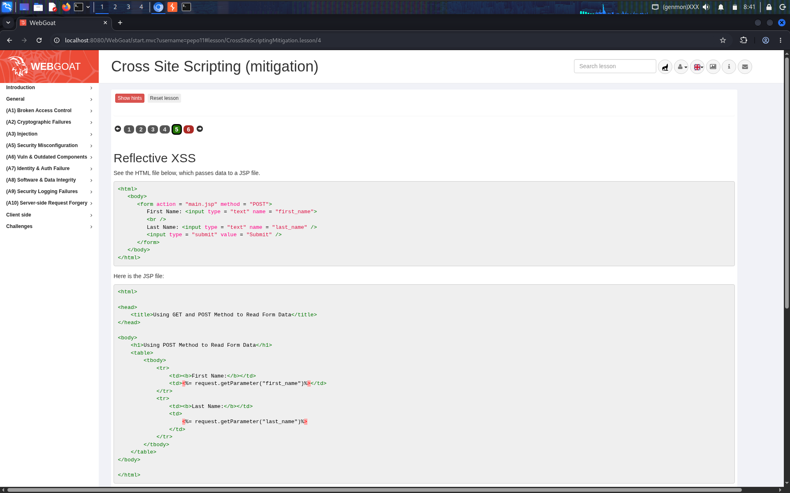
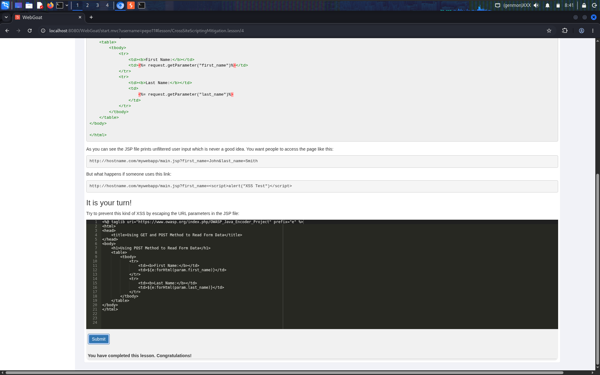
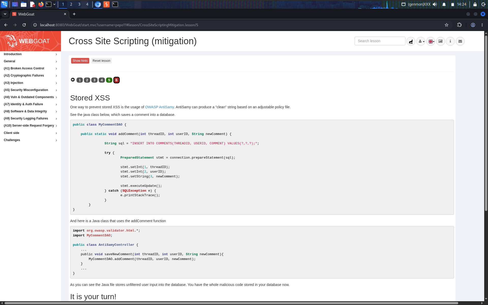
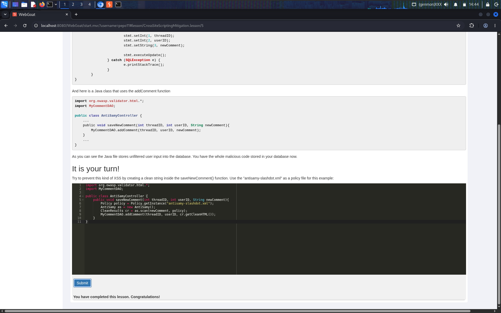

# Cross-Site Scripting (Mitigation) — WebGoat Lesson: A3 Injection

**Category:** A3 — Injection
**Difficulty:** Easy–Medium

## Objective

The earlier XSS lessons focused on finding and exploiting reflected, DOM-based, and stored XSS. This lesson flips to the defender's side: given real (if simplified) vulnerable JSP/Java source, patch it so the same attacks no longer work — once for **reflective XSS** (output encoding) and once for **stored XSS** (input sanitization before persistence).

## Vulnerability

Both exercises start from code that takes user-controlled input and either renders it or stores it **without any encoding or sanitization** — the same root cause behind every XSS lesson so far, just viewed from the fix side instead of the attack side.

## Part 1 — Fixing Reflective XSS

**Task 5.** WebGoat shows a small HTML form that posts `first_name` and `last_name` to a JSP page, and the JSP that handles it:

```jsp
<td><%= request.getParameter("first_name") %></td>
...
<td><%= request.getParameter("last_name") %></td>
```



The lesson spells out exactly why this is dangerous: a legitimate link looks like `.../main.jsp?first_name=John&last_name=Smith`, but nothing stops an attacker from sending `.../main.jsp?first_name=<script>alert("XSS Test")</script>` instead — the parameter is echoed into the HTML response verbatim, so the browser executes it as a real `<script>` tag. This is exactly the reflected-XSS pattern exploited in the earlier (non-mitigation) Cross-Site Scripting lesson.

**Fix applied:** used the OWASP Java Encoder Project's JSP tag library (`e:forHtml`) to HTML-encode each parameter at the point of output, instead of printing it raw:

```jsp
<%@ taglib uri="https://www.owasp.org/index.php/OWASP_Java_Encoder_Project" prefix="e" %>
...
<td>${e:forHtml(param.first_name)}</td>
...
<td>${e:forHtml(param.last_name)}</td>
```

`forHtml()` escapes the characters that give HTML/JavaScript its special meaning (`<`, `>`, `&`, `"`, `'`), so even if an attacker submits `<script>alert("XSS Test")</script>`, the browser renders it as inert, visible text (`&lt;script&gt;alert(&quot;XSS Test&quot;)&lt;/script&gt;`) instead of executing it as markup:



## Part 2 — Fixing Stored XSS

**Task 6.** This exercise simulates a comment-saving feature — the same kind of sink exploited in the Stored XSS lesson. A `MyCommentDAO.addComment()` method safely inserts a comment into the database using a parameterized `PreparedStatement` (so it's not vulnerable to *SQL* injection), but the calling code passes the raw, unsanitized comment straight through:

```java
public void saveNewComment(int threadID, int userID, String newComment){
    MyCommentDAO.addComment(threadID, userID, newComment);
}
```



As the lesson notes, this means whatever HTML/JavaScript a user types into their comment — `<script>...</script>` included — gets written into the database as-is. Unlike the reflective case, this isn't fixable with output encoding alone at render time only; the malicious markup is now sitting in persistent storage and will be served to every future viewer of that thread, exactly as demonstrated in the Stored XSS exploitation lesson.

**Fix applied:** used **OWASP AntiSamy**, a library purpose-built for sanitizing untrusted HTML against an allow-list policy, to "clean" the comment *before* it's ever persisted:

```java
public void saveNewComment(int threadID, int userID, String newComment){
    Policy policy = Policy.getInstance("antisamy-slashdot.xml");
    AntiSamy as = new AntiSamy();
    CleanResults cr = as.scan(newComment, policy);
    MyCommentDAO.addComment(threadID, userID, cr.getCleanHTML());
}
```

AntiSamy parses the submitted HTML against the supplied policy file (`antisamy-slashdot.xml` — a pre-built policy modeled on what a site like Slashdot would allow in comments: basic formatting, but no `<script>`, no inline event handlers, no `javascript:` URLs) and strips out anything that isn't on the allow-list. Only the resulting `cr.getCleanHTML()` — guaranteed free of executable script — is ever written to the database:



## Why It Worked (the original bugs) / Why the Fix Works

- **Reflective case**: the original JSP trusted that `request.getParameter()` would only ever contain "normal" text, and printed it into the HTML response with zero transformation — so attacker-supplied markup became real markup. `e:forHtml()` fixes this by encoding at the output boundary, the exact point where "data" risks being reinterpreted as "code."
- **Stored case**: the original code treated "safely inserted into the database" (via a `PreparedStatement`) as equivalent to "safe," but SQL-injection safety and XSS safety are two completely different problems — a `PreparedStatement` stops SQL syntax injection, it does nothing about HTML/JS content sitting inside a perfectly valid string value. AntiSamy closes that gap by sanitizing the *content* itself, independent of how it's stored.
- **Allow-list over block-list**: AntiSamy's policy-file approach (allow only specific known-safe tags/attributes) is inherently more robust than trying to blacklist dangerous patterns like `<script>`, `onerror=`, `javascript:`, etc. — blacklists are notoriously easy to bypass with obfuscation or alternate encodings; allow-lists aren't.

## Remediation

- **Always HTML-encode untrusted data at the point it is rendered into HTML**, using a well-vetted encoding library (OWASP Java Encoder, or the equivalent for your stack) rather than hand-rolled escaping.
- **Treat "safely stored" and "safe to render" as two separate guarantees.** Parameterized queries solve SQL injection; they say nothing about whether the *content* of a stored string is safe to later output as HTML.
- **Sanitize untrusted HTML with an allow-list library (e.g., OWASP AntiSamy) before persisting it**, especially for any field — comments, bios, forum posts — where users might legitimately want some rich-text formatting but must not be allowed to supply `<script>`, event-handler attributes, or `javascript:` URLs.
- **Still encode on output, even after sanitizing on input** — defense in depth. Sanitization policies can have gaps or be misconfigured; output encoding is a second independent layer that catches what the first one misses.
- **Add a Content-Security-Policy (CSP) header** disallowing inline scripts as a third layer, so that even a successful bypass of both encoding and sanitization fails to execute.

## References

- [OWASP Top 10 2021 – A03: Injection](https://owasp.org/Top10/A03_2021-Injection/)
- [OWASP Cross Site Scripting (XSS) Prevention Cheat Sheet](https://cheatsheetseries.owasp.org/cheatsheets/Cross_Site_Scripting_Prevention_Cheat_Sheet.html)
- [OWASP Java Encoder Project](https://owasp.org/www-project-java-encoder/)
- [OWASP AntiSamy Project](https://owasp.org/www-project-antisamy/)
- [CWE-79: Improper Neutralization of Input During Web Page Generation ('Cross-site Scripting')](https://cwe.mitre.org/data/definitions/79.html)
