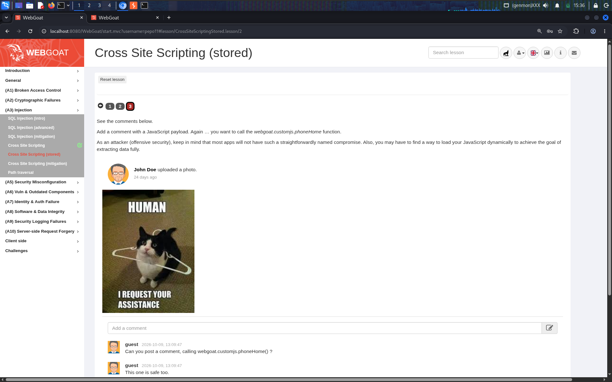
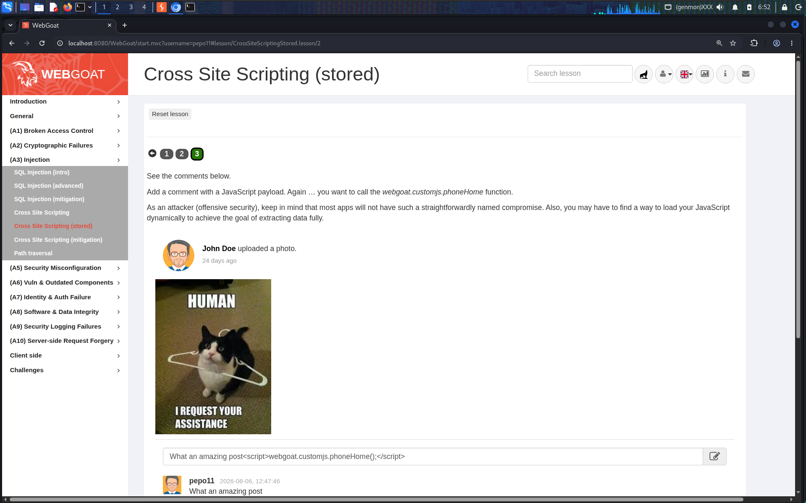
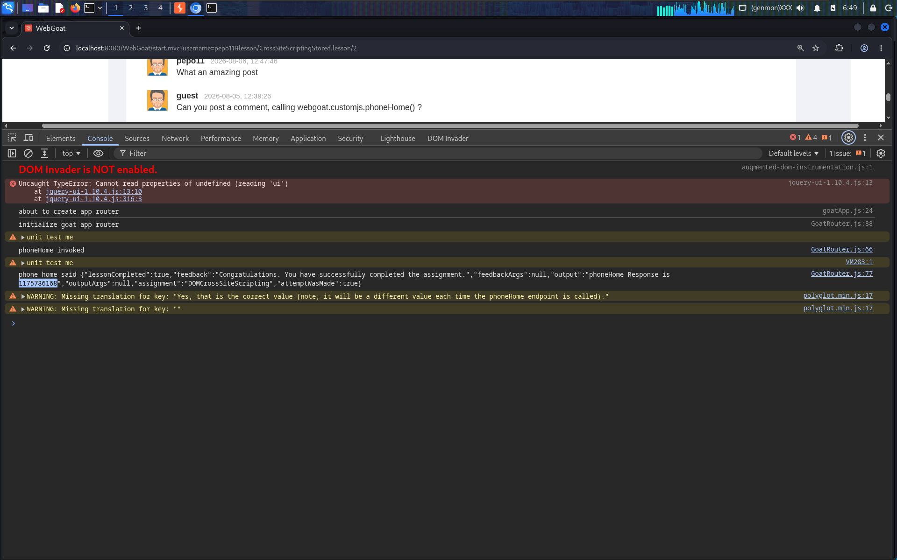
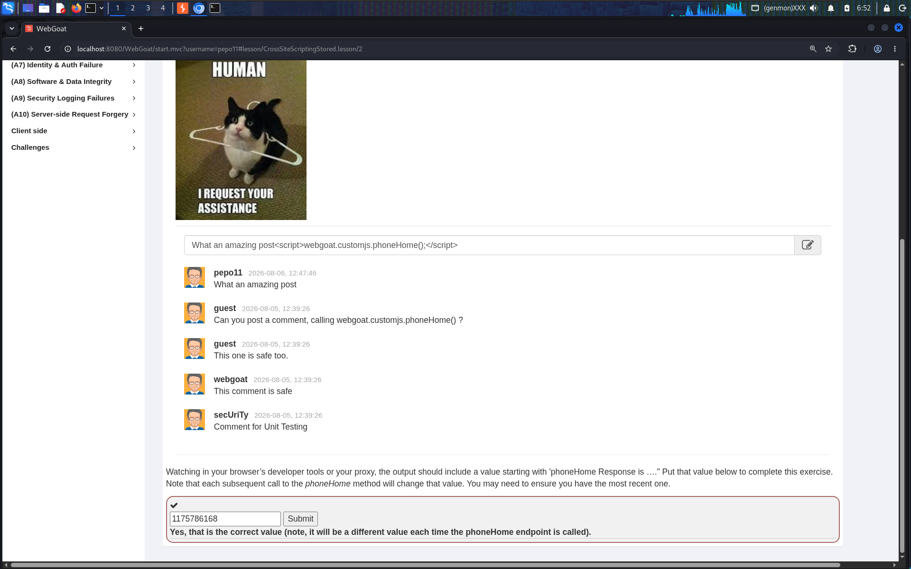

# Cross-Site Scripting (Stored) — WebGoat Lesson: A3 Injection

**Category:** A3 — Injection
**Difficulty:** Medium

## Objective

Demonstrate a **stored (persistent) XSS** attack: inject a JavaScript payload into a field that gets saved server-side and re-rendered to every visitor of the page (a comment thread), so the payload executes for anyone who simply *views* the page later — with no further action from the attacker required.

## Vulnerability

Unlike reflected XSS, where the payload only exists for a single request/response, stored XSS persists on the server (in a database, file, or similar) and is served back out as part of normal page content to every subsequent visitor. This makes it significantly more dangerous: one successful injection can compromise every user who later views the affected page — including, in a real application, administrators or moderators with elevated privileges.

The vulnerable page here is a simple comment/image-upload thread. The application takes whatever text a user submits as a comment and renders it back into the page without sanitizing or encoding HTML/script tags.

## Exploitation Steps

**Task 3.** The assignment: post a comment containing a JavaScript payload that calls WebGoat's internal `webgoat.customjs.phoneHome()` function — and note that, unlike the earlier reflected-XSS exercises, this time the exploit has to actually get *stored* and reflected back on page render, not just fired once.

The comment thread already contains an uploaded photo and a couple of prior comments hinting at the goal:



**Payload used (comment field):**

```html
What an amazing post<script>webgoat.customjs.phoneHome();</script>
```

Prefixing the payload with ordinary-looking text (`What an amazing post`) keeps the comment looking legitimate to anyone casually reading the thread, while the appended `<script>` tag does the actual damage. Submitted this as a new comment:



Because the application does not encode the stored comment text when rendering the page, the `<script>` tag is parsed and executed by the browser **every time the page loads** — not just at submission time. Opening the DevTools console confirms the full execution chain fired automatically on page render:

```
phoneHome invoked
phone home said {"lessonCompleted":true,"feedback":"Congratulations. You have successfully completed the assignment.","feedbackArgs":null,"output":"phoneHome Response is 1175786168","outputArgs":null,"assignment":"DOMCrossSiteScripting","attemptWasMade":true}
```



Scrolled down to the comment thread and completion field — the injected comment now sits alongside the other (legitimate) comments, visually indistinguishable from them since the `<script>` tag itself renders nothing visible — and submitted the one-time response value returned by `phoneHome()`:



## Why It Worked

- **No output encoding on persisted/stored content**: the comment text was written to the backend and rendered back into the page's HTML without HTML-encoding, so an attacker-supplied `<script>` tag became a real, executable script on every page load.
- **No input sanitization at write time either**: a reasonable allow-list (plain text only, or a restricted Markdown/BBCode subset with no raw HTML) on the comment submission endpoint would have stopped the payload before it was ever stored.
- **Execution is automatic and silent**: because the payload fires on page render rather than requiring any further victim interaction, every single visitor to the comment thread — including, in a real app, higher-privileged users like moderators or admins reviewing content — would have the script run in their session automatically.
- **No Content Security Policy (CSP)**: as with the reflected and DOM-based cases, a CSP that disallows inline script execution would have blocked this even without perfect output encoding.

## Remediation

- **HTML-encode all user-generated content on output**, every time it's rendered — regardless of how "trusted" the source field feels (a "comment" field is exactly the kind of free-text field attackers target first).
- **Sanitize on the way in too**, using an allow-list approach (e.g., a vetted library like DOMPurify, or disallowing HTML entirely in favor of a safe Markdown subset) — defense in depth means not relying on output encoding alone.
- **Treat stored/persistent fields as higher risk than one-off reflected fields**: a stored XSS bug has a much larger blast radius (every viewer, indefinitely, until the content is removed) and should be prioritized accordingly in security testing.
- **Deploy a strict Content Security Policy (CSP)** disallowing `unsafe-inline` scripts, so that even a successful injection fails to execute.
- **Mark session cookies `HttpOnly` and `Secure`** so that even a successful stored-XSS payload cannot read and exfiltrate `document.cookie` for session hijacking.
- **Review/moderate user-generated content** (automated scanning plus human moderation for high-risk surfaces like public comment threads) as an additional layer, since no single technical control is perfect.

## References

- [OWASP Top 10 2021 – A03: Injection](https://owasp.org/Top10/A03_2021-Injection/)
- [OWASP Cross Site Scripting (XSS) Prevention Cheat Sheet](https://cheatsheetseries.owasp.org/cheatsheets/Cross_Site_Scripting_Prevention_Cheat_Sheet.html)
- [CWE-79: Improper Neutralization of Input During Web Page Generation ('Cross-site Scripting')](https://cwe.mitre.org/data/definitions/79.html)
- [PortSwigger: Stored XSS](https://portswigger.net/web-security/cross-site-scripting/stored)
