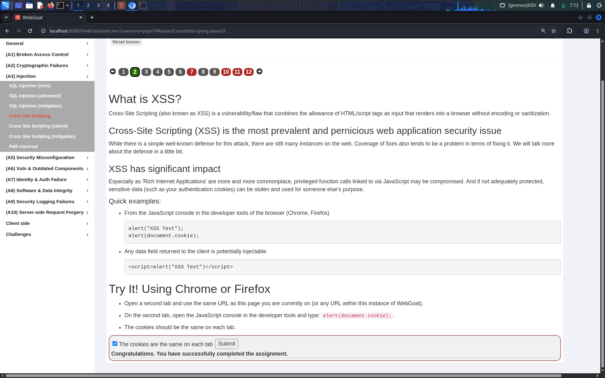
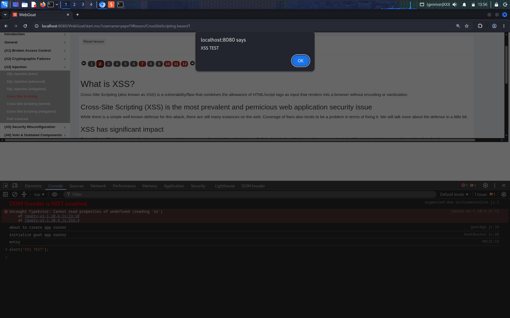
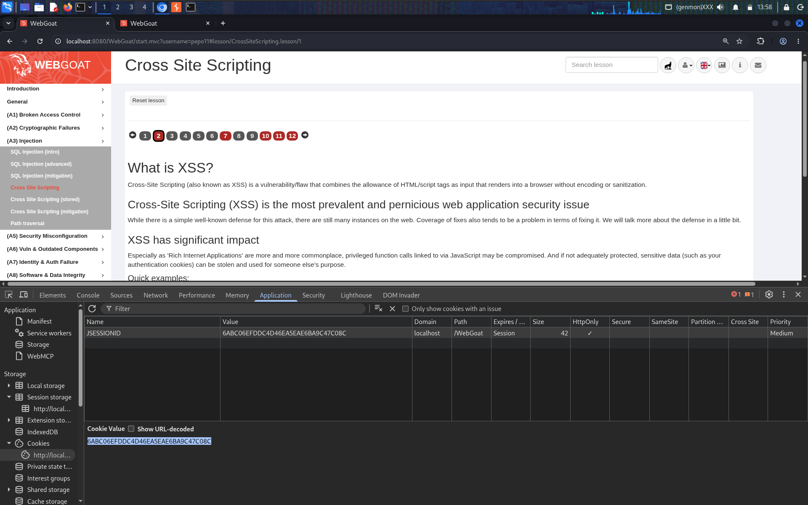
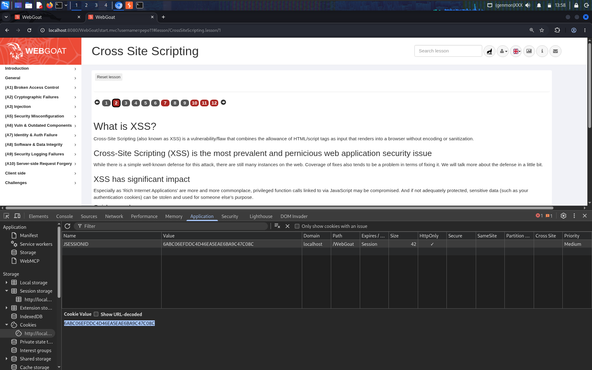
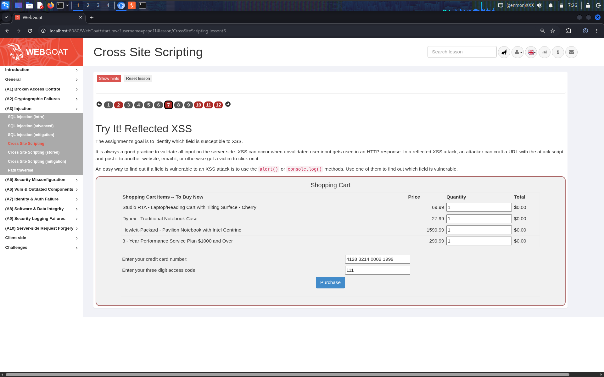
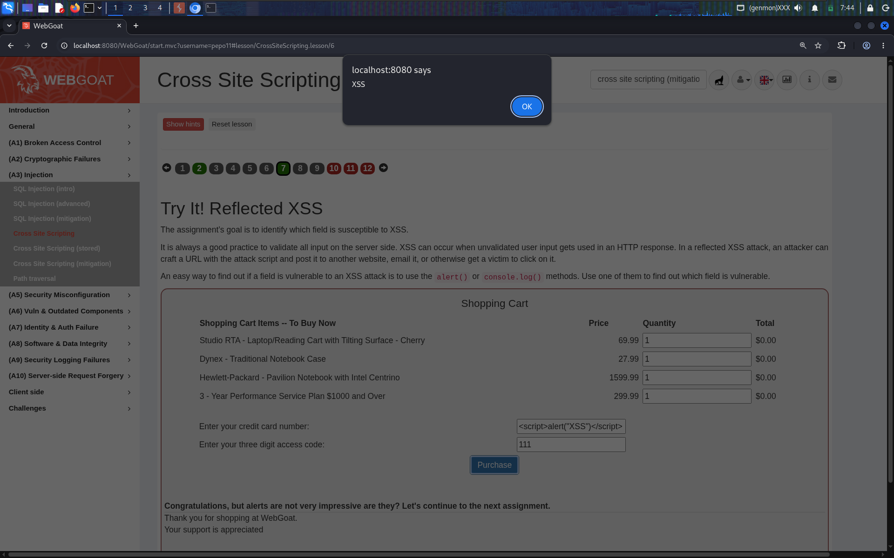
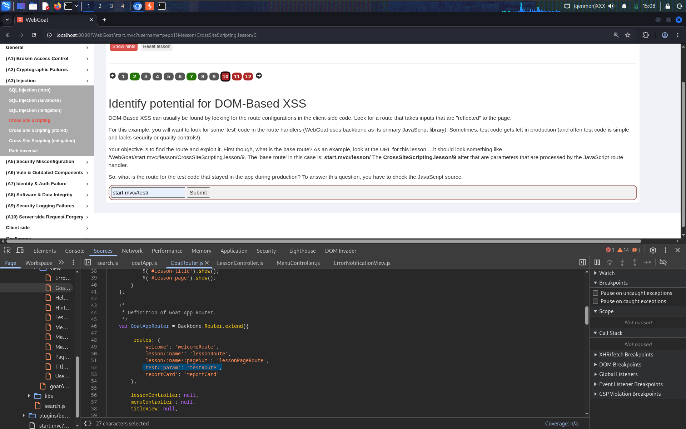
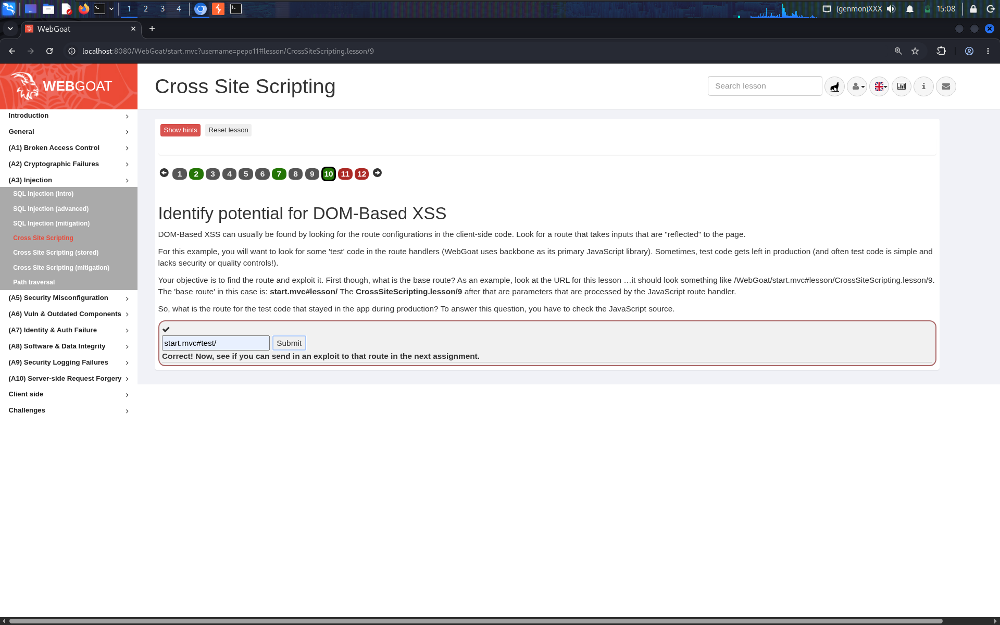
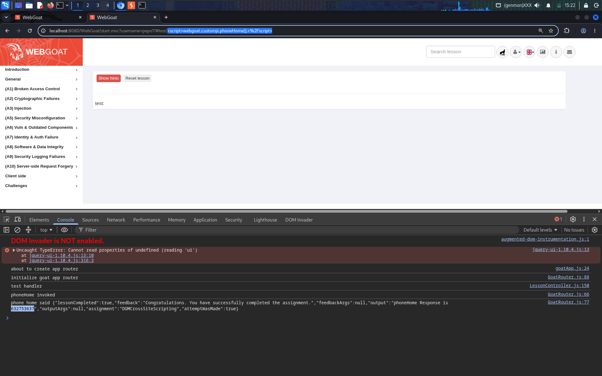
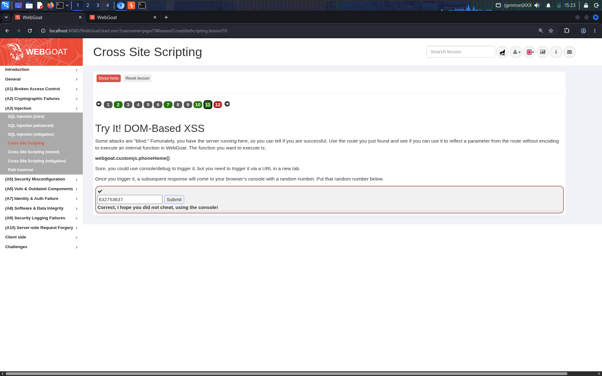

# Cross-Site Scripting (XSS) — Reflected & DOM-Based — WebGoat Lesson: A3 Injection

**Category:** A3 — Injection
**Difficulty:** Easy–Medium

## Objective

This lesson introduces Cross-Site Scripting (XSS) from the ground up: what it is, why it matters (session cookie theft), and then two concrete exploitation paths — **Reflected XSS** (a payload in a request is echoed straight back into the HTML response) and **DOM-Based XSS** (a payload is processed entirely client-side by JavaScript, never touching the server at all).

## Vulnerability

XSS is a flaw that lets an attacker get their own HTML/JavaScript to render and execute inside a victim's browser, in the security context of the vulnerable site. It happens whenever user-controlled input is placed into a page (or into the DOM) without proper encoding or sanitization, so the browser can't tell the difference between "data" and "code." Once a script runs in that context, it can read anything the page can read — including, in many real-world cases, the user's session cookie.

## Part 1 — Why XSS Matters: Reading the Session Cookie

Before exploiting anything, the lesson demonstrates the underlying risk: JavaScript running on a page can read `document.cookie`, and that cookie is shared across every tab pointed at the same site.

Confirmed that a cookie set in one tab is visible and identical in a second tab of the same browser:



Ran a simple proof-of-concept directly in the DevTools console to show arbitrary script execution:

```js
alert("XSS Test");
```



Inspected the actual `JSESSIONID` cookie value via DevTools → Application → Cookies, first in one tab:



...and confirmed the identical value is present in a second tab against the same host:



This is the real-world payoff of XSS: `alert()` is harmless, but `document.cookie` is not — a script run via XSS can silently exfiltrate that session identifier to an attacker-controlled server, allowing full session hijacking without ever knowing the victim's password.

## Part 2 — Reflected XSS

**Task 7.** Goal: identify which field in a shopping-cart checkout form is vulnerable to XSS by injecting a payload and watching for it to fire.



**Payload used (credit card number field):**

```html
<script>alert("XSS")</script>
```

Entered the payload into the "credit card number" field and clicked **Purchase**. The server reflected the raw input straight back into the response HTML, and the browser parsed and executed the injected `<script>` tag as part of the page:



This is a textbook **reflected XSS**: the payload is not stored anywhere — it only exists for the duration of this one request/response cycle. A real attacker would deliver this via a crafted link (e.g., a malicious URL with the payload as a query/form parameter), sent via phishing email or a malicious site, relying on the victim to click it while authenticated.

## Part 3 — DOM-Based XSS

DOM-based XSS is different from reflected/stored XSS: the payload never has to be sent to or processed by the server at all. It is entirely a client-side JavaScript bug, where untrusted data (often read straight from `location.hash`/the URL fragment, which never even gets sent to the server) is used unsafely inside the page's own DOM-manipulating code.

**Task 10.** Goal: find the "hidden" route in WebGoat's own client-side JavaScript router. The lesson's hint: this app uses **Backbone.js** for client-side routing, and leftover test code in the route table is a common source of unvetted DOM-XSS entry points.

Opened DevTools → Sources and inspected `GoatRouter.js`, finding the route table — alongside the expected `lesson/:name`, `lesson/:name/:pageNum`, and `reportCard` routes, there's an undocumented one:

```js
routes: {
    'welcome': 'welcomeRoute',
    'lesson/:name': 'lessonRoute',
    'lesson/:name/:pageNum': 'lessonPageRoute',
    'test/:param': 'testRoute',
    'reportCard': 'reportCard'
},
```



Submitted the base route for this test handler — `start.mvc#test/` — and confirmed it:



**Task 11.** Goal: actually exploit that route. The target: trigger WebGoat's internal `webgoat.customjs.phoneHome()` function purely by navigating to a crafted URL (not via the console), and recover the one-time response value it returns.

**Payload (as the URL fragment parameter):**

```
<script>webgoat.customjs.phoneHome();</script>
```

**Full exploit URL:**

```
http://localhost:8080/WebGoat/start.mvc?username=pepo11#test/<script>webgoat.customjs.phoneHome();</script>
```

Navigating to this URL causes the `testRoute` handler to take the `:param` straight from the URL fragment and pass it — unsanitized — into the page's DOM/test-code path, which executes it as a script. The DevTools console confirms the full chain: the test handler runs, invokes `phoneHome`, and logs the server's response, including a random one-time value (`632753637` in this run):



Submitted that value to complete the assignment — note the lesson explicitly checks that it was triggered via a real URL navigation and not just typed into the console:



## Why It Worked

- **No output encoding on reflected input**: the shopping-cart field's value was echoed back into the HTML response verbatim, so a `<script>` tag in the input became a real `<script>` tag in the DOM.
- **Leftover test/debug code shipped to production**: the `test/:param` Backbone route was never meant to be reachable outside development, but it stayed wired into the live router with no access control or sanitization.
- **Untrusted data read directly from the URL into executable context**: DOM-based XSS is especially dangerous because the payload (in the URL fragment, after the `#`) is never even sent to the server — meaning server-side filters, WAFs, and logging can completely miss the attack.
- **No Content Security Policy (CSP)**: a well-configured CSP would have blocked inline `<script>` execution outright, regardless of how the payload got into the page.

## Remediation

- **Contextual output encoding**: HTML-encode any user-controlled data before it is rendered into HTML (`<` → `&lt;`, `>` → `&gt;`, etc.), and use the encoding appropriate to the context (HTML body, HTML attribute, JavaScript string, URL) rather than a single blanket filter.
- **Never trust the URL, including the fragment**: client-side routers must treat route parameters — including anything read from `location.hash` — as untrusted input, just like a server would treat a query string.
- **Remove debug/test routes before shipping**: leftover developer convenience code is a common, avoidable source of real vulnerabilities; test-only routes should never exist in a production build.
- **Deploy a strict Content Security Policy (CSP)**: disallowing `unsafe-inline` scripts (and ideally using nonces/hashes for legitimate inline scripts) stops injected `<script>` tags from executing even if an encoding bug slips through.
- **Mark session cookies `HttpOnly` and `Secure`**: this prevents `document.cookie` from being readable by JavaScript at all, neutralizing the most damaging real-world consequence of XSS (session hijacking) even if an XSS bug exists elsewhere.
- **Use a modern frontend framework correctly**: frameworks like React/Vue auto-escape rendered content by default — most real-world DOM XSS comes from explicitly bypassing that (e.g., `dangerouslySetInnerHTML`, `v-html`, or raw `innerHTML` assignment) without a very good reason.

## References

- [OWASP Top 10 2021 – A03: Injection](https://owasp.org/Top10/A03_2021-Injection/)
- [OWASP Cross Site Scripting (XSS) Prevention Cheat Sheet](https://cheatsheetseries.owasp.org/cheatsheets/Cross_Site_Scripting_Prevention_Cheat_Sheet.html)
- [OWASP DOM based XSS Prevention Cheat Sheet](https://cheatsheetseries.owasp.org/cheatsheets/DOM_based_XSS_Prevention_Cheat_Sheet.html)
- [CWE-79: Improper Neutralization of Input During Web Page Generation ('Cross-site Scripting')](https://cwe.mitre.org/data/definitions/79.html)
- [PortSwigger: Cross-site scripting](https://portswigger.net/web-security/cross-site-scripting)
