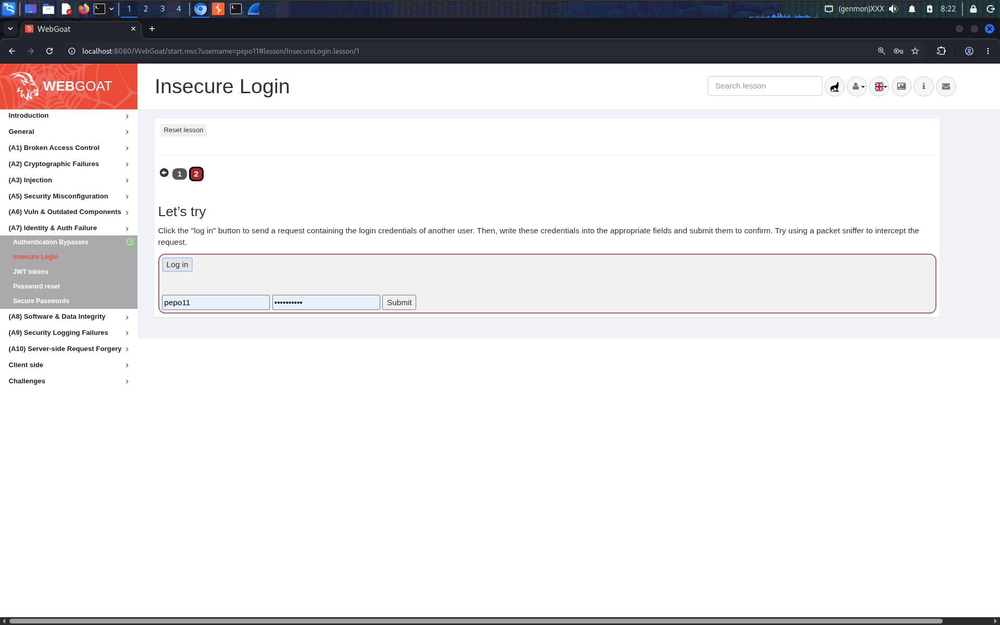
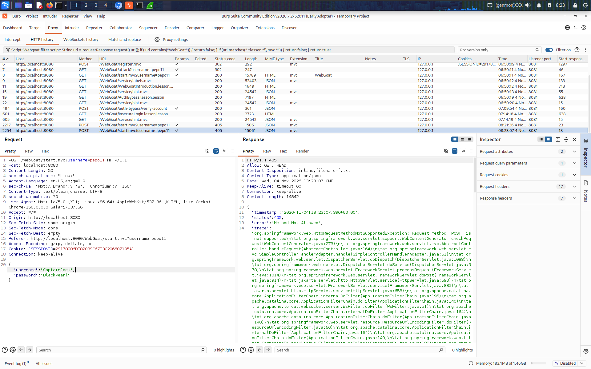
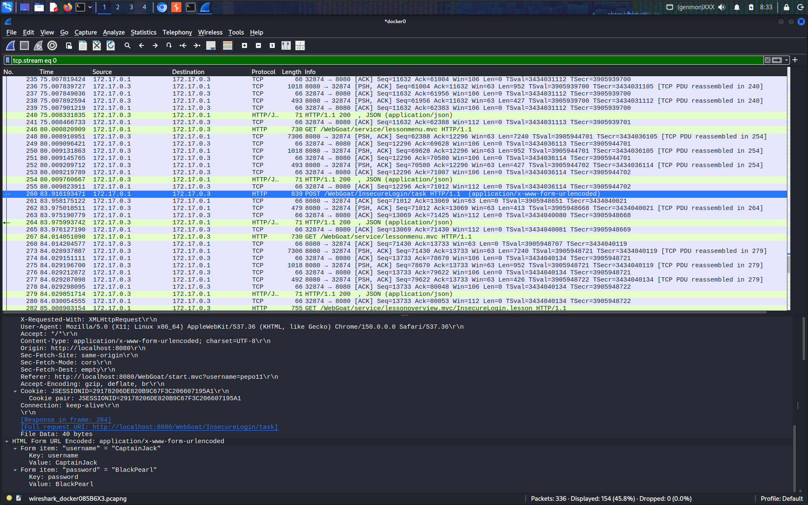
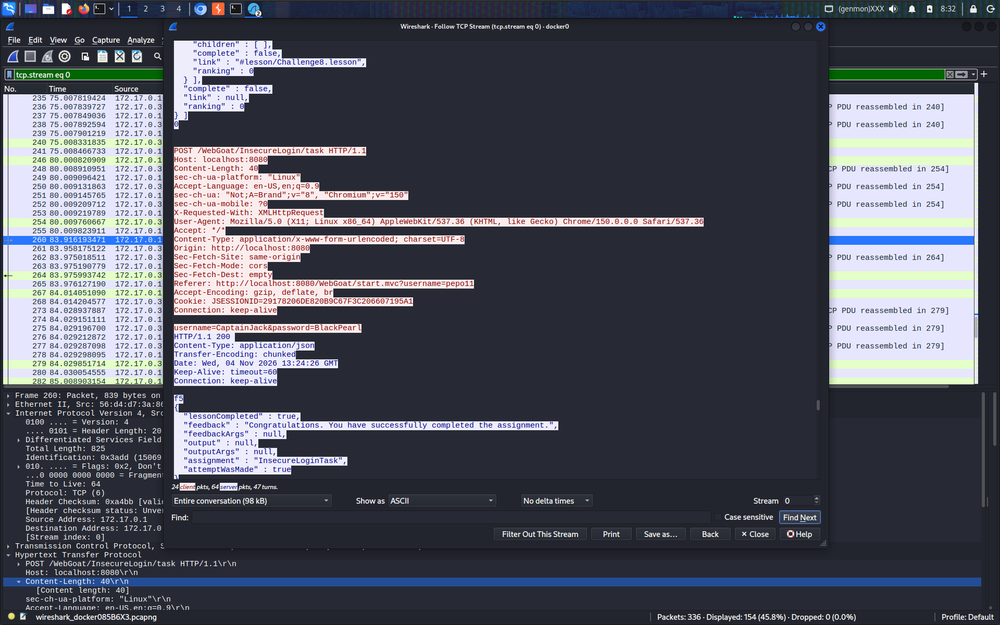
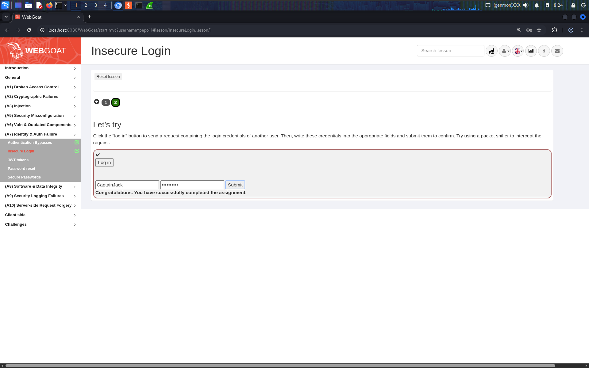

# Insecure Login — Credential Sniffing over Cleartext HTTP — WebGoat

**Category:** A7 Identification and Authentication Failures
**Lesson:** Insecure Login

## Objective

Show that logging in over plain HTTP (no TLS) means the username and password travel across the network in plaintext — anyone positioned to observe the traffic (same Wi-Fi, a compromised router, an ISP, a man-in-the-middle) can simply read the credentials straight out of the packets, no cracking or exploitation required.

## Vulnerability

This is **CWE-319: Cleartext Transmission of Sensitive Information**. The lesson's login form posts `username` and `password` as plain, unencrypted form fields over HTTP. Without TLS, every hop between the browser and the server carries that data in the clear. A packet capture tool like Wireshark doesn't need to break anything — it just needs to be listening.

## Exploitation Steps

1. Lesson overview — a simple login form (`Insecure Login`) explaining the goal: capture the credentials in transit rather than guess them.

   

2. First check in Burp hit the wrong endpoint and got a `405 Method Not Allowed` — confirmed the actual login POST target before setting up the capture.

   

3. Started a Wireshark capture on the loopback/local interface, then submitted the login form on the page with sample credentials.

   

4. Right-clicked the `POST /WebGoat/InsecureLogin/task` packet and chose **Follow → TCP Stream** (filter: `tcp.stream eq N`). The reassembled stream showed the full HTTP request body in plaintext:

   ```
   username=CaptainJack&password=BlackPearl
   ```

   

5. Submitted the recovered credentials back into the lesson to confirm the capture was correct — lesson marked complete.

   

## Why It Worked

HTTP has no built-in confidentiality — every byte of the request, including form body fields like `username` and `password`, is sent as readable text at the TCP layer. Wireshark just reassembles the TCP stream and displays it; there's no encryption to defeat. The only thing that would have stopped this is TLS (HTTPS), which encrypts the entire request (and response) before it ever leaves the client, so an observer on the wire sees ciphertext instead of `username=CaptainJack&password=BlackPearl`.

## Remediation

- **Enforce HTTPS everywhere**, especially on login and any endpoint carrying credentials or session tokens — redirect all HTTP traffic to HTTPS and use `HSTS` (`Strict-Transport-Security`) so browsers refuse to fall back to plaintext.
- **Never submit credentials over a form that posts to an `http://` URL**, even if the surrounding page is served over HTTPS — mixed content undermines the protection.
- **Use secure, `HttpOnly`, `SameSite` cookies for session tokens** once authenticated, so even post-login traffic isn't trivially replayable if captured.
- **Treat this as a network-layer problem, not an application-logic one** — no amount of server-side validation fixes a credential sent in the clear; the fix has to happen in transport (TLS termination, certificate management, HSTS).

## References

- [OWASP – Cleartext Transmission of Sensitive Information (CWE-319)](https://cwe.mitre.org/data/definitions/319.html)
- [OWASP Transport Layer Protection Cheat Sheet](https://cheatsheetseries.owasp.org/cheatsheets/Transport_Layer_Security_Cheat_Sheet.html)
- [MDN – HTTP Strict Transport Security (HSTS)](https://developer.mozilla.org/en-US/docs/Web/HTTP/Headers/Strict-Transport-Security)
